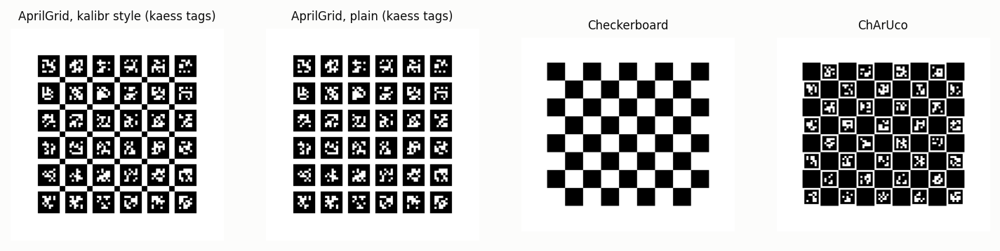
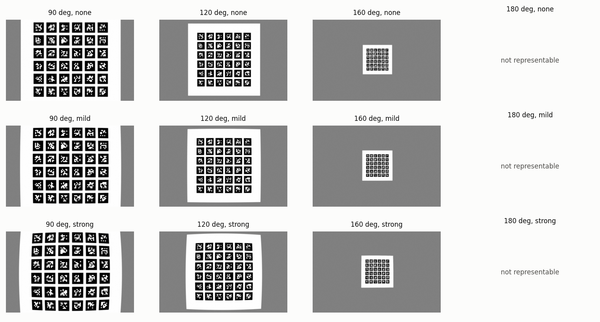
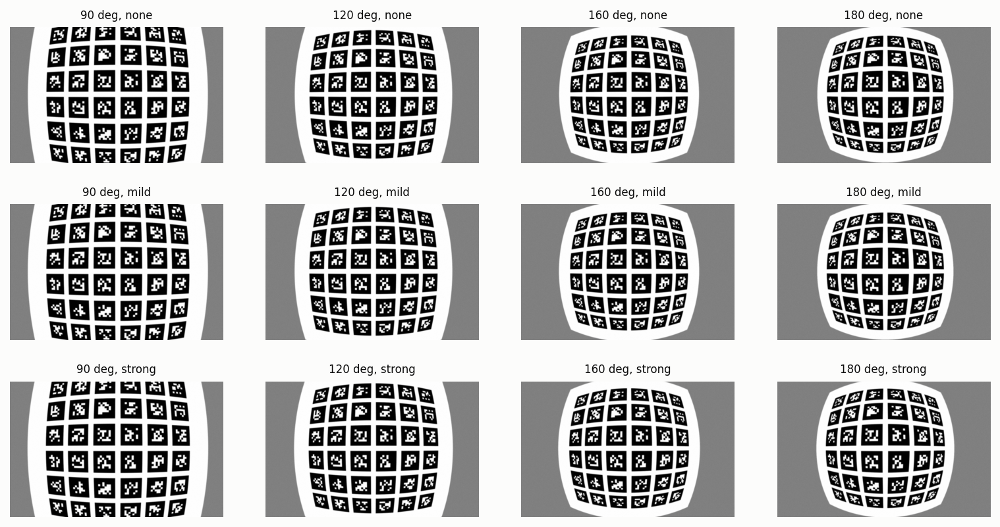
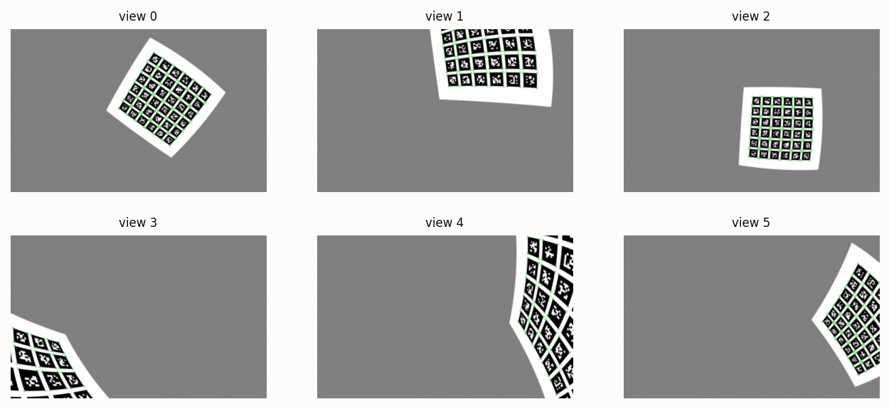
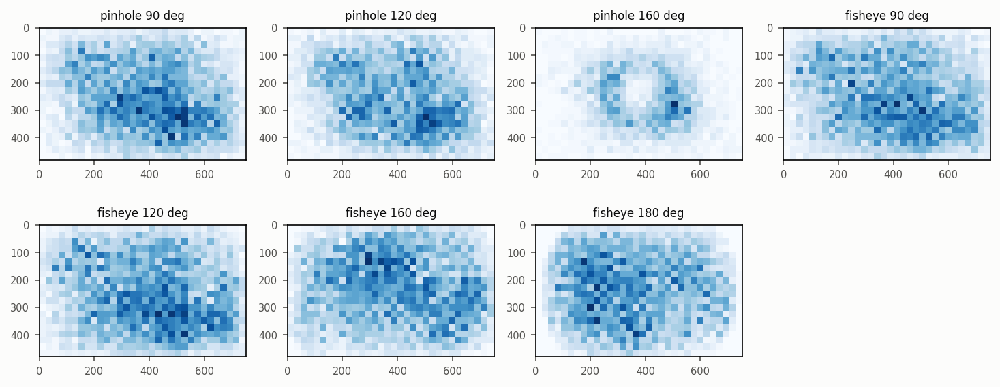
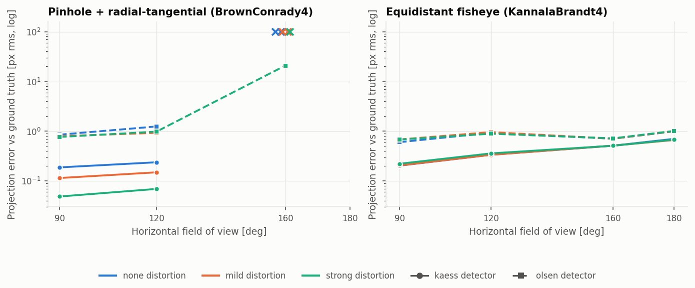
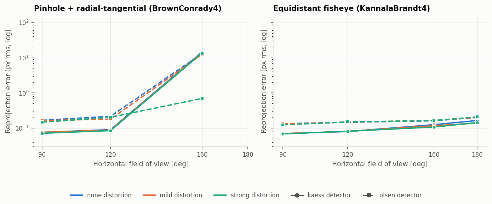
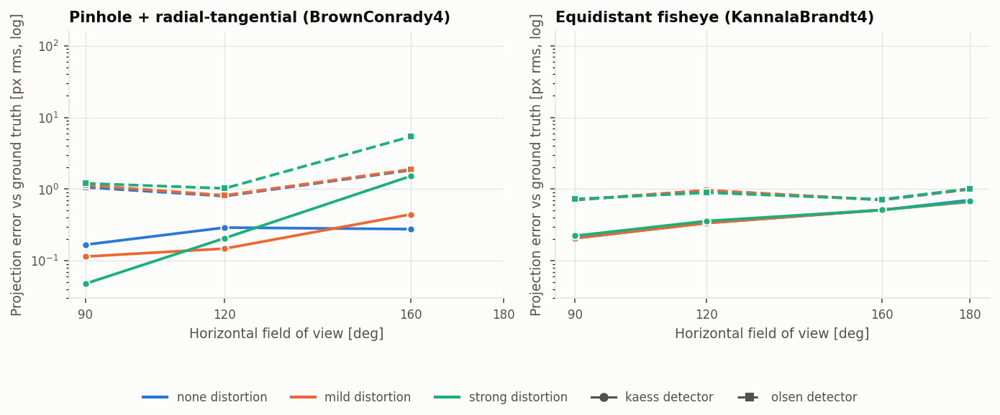
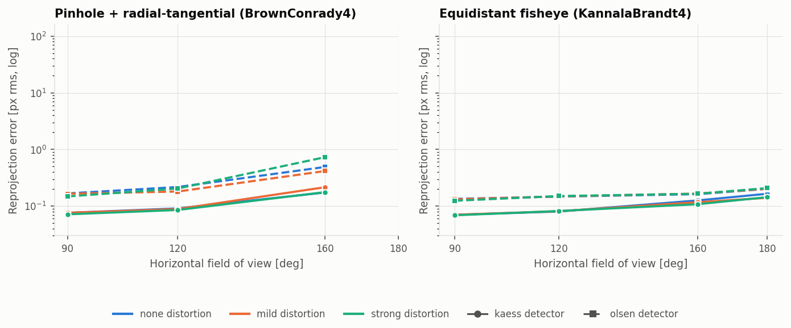

========================================================================
Camera calibration accuracy report
========================================================================

Corners of a plain AprilGrid are detected in simulated images from
cameras with horizontal fields of view of 90, 120, 160, 180
degrees and with varying amounts of distortion, and are put through
``CalibCamera``. The recovered camera is compared against the ground truth
camera that rendered the images.

Each camera is simulated with ``80`` views of the board, with the
board placed at random locations across the whole image, and is calibrated
twice for each of the two AprilGrid detectors (``kaess`` and ``olsen``): once
from the calibrator's default initial guess, and once from a guess near the
ground truth.

Summary
=======

- **Fisheye (KannalaBrandt4), kaess detector:** every camera converged from the default initial guess (12 of 12), at all fields of view up to 180 degrees and all distortion levels. The projection error is 0.20 - 0.70 px rms (6 of 12 within 0.5 px), and it grows with the field of view. The focal length is off by -0.46 to -0.09 % and the principal point by at most 0.19 px.

- **Pinhole (BrownConrady4), kaess detector:** at 90 and 120 degrees the camera is recovered to 0.05 - 0.24 px rms for all distortion levels. At 160 degrees the calibration diverged from the default initial guess in 3 of 3 cases (reprojection error above 10 px), but from a guess near the ground truth it converged to 0.28 - 1.51 px rms, so the failure is the initialisation, not the model. A pinhole camera cannot represent 180 degrees.

- **olsen detector:** the principal point is off by +0.57 px in x and +0.50 px in y on average (kaess: +0.01 and +0.00 px). This matches the half pixel offset of the olsen corners found in the detector experiment, which the calibration absorbs into the principal point. The projection error is 0.60 - 20.89 px rms when it converges.

- **The reprojection error does not show it:** the calibrator reports 0.10 px (kaess) and 0.21 px (olsen) on average, so a constant corner offset is not visible in the residuals, only in the recovered parameters. The worst case is BrownConrady4 at 160 degrees with strong distortion (olsen, default initial guess), which reports 0.70 px while its projection error is 20.9 px.

- **Limits of the camera models:** both models project through the plane ``z = 1``, so rays at or beyond 90 degrees off the optical axis cannot be represented. Corners beyond 85 degrees are dropped, so at 180 degrees the calibration only uses the inner 170 degree cone and the image corners are unused.

Setup
=====

.. list-table::
   :header-rows: 1
   :align: center
   :width: 80%
   :widths: 40 60

   * - Setting
     - Value
   * - Resolution
     - 752x480
   * - Principal point offset
     - (+4.0, -3.0) px from the center
   * - fy / fx
     - 1.004
   * - Views per camera
     - 80
   * - Distance to board
     - 90 deg: 0.5-1.5 m, 120 deg: 0.4-1.2 m, 160 deg: 0.3-0.8 m, 180 deg: 0.25-0.6 m
   * - Tilt of the camera about the board
     - 0 - 60 deg
   * - Corners further off the optical axis than
     - 85 deg are dropped
   * - Image
     - blur sigma 0.8 px, noise sigma 2.0 levels
   * - Seed
     - 42

The ground truth cameras are built so that the horizontal image edge, through
the principal point, sees exactly the stated field of view:

- **BrownConrady4**: a pinhole camera with radial-tangential distortion. The
  radial distortion is given as the fraction by which the horizontal image
  edge is displaced, so the levels are comparable across fields of view.
  *none* is 0 %, *mild* is -3 % and *strong* is -12 % with an opposing second
  order term, plus tangential terms.
- **KannalaBrandt4**: an equidistant fisheye camera. *none* is the pure
  equidistant projection and the coefficients ``k1..k4`` of *mild* and
  *strong* are in the table of distortion coefficients below.

A pinhole camera cannot see 180 degrees, so that combination is not
simulated. Projections with the distortion folding the image over are also
rejected before any simulation.

Calibration targets
===================

``CalibCamera`` only accepts AprilGrid targets, so the calibration uses the
plain AprilGrid. The kalibr style grid, checkerboard and ChArUco board from the
detector experiment are shown for reference.

   The calibration targets. The AprilGrid tags are rendered with the tag code table of the ``kaess`` detector.

Camera views
============

The same view of the board, looking straight at it, as seen by each simulated
camera. The board is placed at the closest distance used for that field of
view.

   Pinhole + radial-tangential (BrownConrady4): rows are distortion levels and columns are horizontal fields of view.

   Equidistant fisheye (KannalaBrandt4): rows are distortion levels and columns are horizontal fields of view.

Calibration data
================

Example calibration views with the detected corners drawn in green, from a
120 degree fisheye camera with strong distortion. Corners further than
85 degrees off the optical axis are dropped,
since ``KannalaBrandt4`` and ``BrownConrady4`` project through the plane
``z = 1`` and cannot represent rays at or beyond 90 degrees.

   Six calibration views with detected corners.

The detected corners over all views of each camera (mild distortion, ``kaess``
detector). The fisheye cameras and the 90 and 120 degree pinhole cameras have
corners across most of the image. The 160 degree pinhole camera only has
corners in a ring around the image center, since the board is too small there
and too stretched towards the edges to be detected.

   Detected corners over the image, all views.

Results
=======

Parameters of different camera models are strongly correlated, in particular
the focal length and distortion coefficients, so comparing coefficients is not
a good measure of how well a camera was recovered. The main measure is the
**projection error**: rays over the image (every 8 pixels, up to
85 degrees off the axis) are projected by the
ground truth and the estimated camera, and the pixel difference is measured
(rms and max). A camera is *recovered* when the rms is at most 0.5 px.

Cameras recovered (rms projection error <= 0.5 px), out of the simulated ones:

.. list-table::
   :header-rows: 1
   :align: center
   :width: 80%

   * - Initial guess
     - Model
     - Detector
     - Recovered
   * - default
     - BrownConrady4
     - kaess
     - 6 / 9
   * - default
     - BrownConrady4
     - olsen
     - 0 / 9
   * - default
     - KannalaBrandt4
     - kaess
     - 6 / 12
   * - default
     - KannalaBrandt4
     - olsen
     - 0 / 12
   * - near_truth
     - BrownConrady4
     - kaess
     - 8 / 9
   * - near_truth
     - BrownConrady4
     - olsen
     - 0 / 9
   * - near_truth
     - KannalaBrandt4
     - kaess
     - 6 / 12
   * - near_truth
     - KannalaBrandt4
     - olsen
     - 0 / 12

Calibrating from the default initial guess
------------------------------------------

   Projection error against the ground truth camera, by field of view. Crosses at the top mark cameras where the calibration diverged or failed. Pinhole at 180 degrees is not simulated.

.. list-table::
   :header-rows: 1
   :align: center
   :width: 80%

   * - Model
     - Distortion
     - FOV [deg]
     - Views
     - Corners
     - kaess rms [px]
     - kaess max [px]
     - olsen rms [px]
     - olsen max [px]
   * - BrownConrady4
     - none
     - 90
     - 80
     - 7,564
     - 0.19
     - 0.52
     - 0.85
     - 1.54
   * - BrownConrady4
     - none
     - 120
     - 80
     - 6,593
     - 0.24
     - 0.67
     - 1.25
     - 3.27
   * - BrownConrady4
     - none
     - 160
     - 80
     - 3,571
     - >100
     - >100
     - >100
     - >100
   * - BrownConrady4
     - none
     - 180
     - n/a
     - n/a
     - n/a
     - n/a
     - n/a
     - n/a
   * - BrownConrady4
     - mild
     - 90
     - 80
     - 7,639
     - 0.11
     - 0.34
     - 0.79
     - 1.32
   * - BrownConrady4
     - mild
     - 120
     - 80
     - 6,676
     - 0.15
     - 0.50
     - 0.93
     - 1.97
   * - BrownConrady4
     - mild
     - 160
     - 80
     - 3,715
     - >100
     - >100
     - >100
     - >100
   * - BrownConrady4
     - mild
     - 180
     - n/a
     - n/a
     - n/a
     - n/a
     - n/a
     - n/a
   * - BrownConrady4
     - strong
     - 90
     - 80
     - 7,754
     - 0.05
     - 0.07
     - 0.77
     - 1.16
   * - BrownConrady4
     - strong
     - 120
     - 80
     - 6,909
     - 0.07
     - 0.14
     - 0.98
     - 2.07
   * - BrownConrady4
     - strong
     - 160
     - 80
     - 3,861
     - >100
     - >100
     - 20.89
     - 44.48
   * - BrownConrady4
     - strong
     - 180
     - n/a
     - n/a
     - n/a
     - n/a
     - n/a
     - n/a
   * - KannalaBrandt4
     - none
     - 90
     - 80
     - 7,949
     - 0.20
     - 0.40
     - 0.60
     - 0.73
   * - KannalaBrandt4
     - none
     - 120
     - 80
     - 7,992
     - 0.34
     - 0.50
     - 0.93
     - 1.18
   * - KannalaBrandt4
     - none
     - 160
     - 80
     - 7,922
     - 0.51
     - 0.75
     - 0.71
     - 1.03
   * - KannalaBrandt4
     - none
     - 180
     - 80
     - 7,708
     - 0.70
     - 0.87
     - 0.99
     - 1.48
   * - KannalaBrandt4
     - mild
     - 90
     - 80
     - 7,971
     - 0.20
     - 0.40
     - 0.68
     - 0.80
   * - KannalaBrandt4
     - mild
     - 120
     - 80
     - 7,987
     - 0.34
     - 0.49
     - 0.96
     - 1.23
   * - KannalaBrandt4
     - mild
     - 160
     - 80
     - 7,894
     - 0.51
     - 0.75
     - 0.71
     - 1.03
   * - KannalaBrandt4
     - mild
     - 180
     - 80
     - 7,679
     - 0.66
     - 0.81
     - 1.00
     - 1.49
   * - KannalaBrandt4
     - strong
     - 90
     - 80
     - 7,982
     - 0.22
     - 0.34
     - 0.68
     - 0.84
   * - KannalaBrandt4
     - strong
     - 120
     - 80
     - 8,034
     - 0.36
     - 0.60
     - 0.89
     - 1.17
   * - KannalaBrandt4
     - strong
     - 160
     - 80
     - 7,894
     - 0.51
     - 0.72
     - 0.72
     - 1.05
   * - KannalaBrandt4
     - strong
     - 180
     - 80
     - 7,739
     - 0.68
     - 0.85
     - 1.01
     - 1.51

   Reprojection error of the calibrator, by field of view. A low reprojection error does not mean the camera was recovered, see the projection error.

Parameter errors, ``kaess`` detector:

.. list-table::
   :header-rows: 1
   :align: center
   :width: 80%

   * - Model
     - Distortion
     - FOV [deg]
     - fx error [%]
     - fy error [%]
     - cx error [px]
     - cy error [px]
     - Reproj. rmse [px]
     - Result
   * - BrownConrady4
     - none
     - 90
     - +0.04
     - +0.04
     - -0.07
     - +0.00
     - 0.076
     - recovered
   * - BrownConrady4
     - none
     - 120
     - +0.04
     - +0.04
     - +0.04
     - +0.00
     - 0.091
     - recovered
   * - BrownConrady4
     - none
     - 160
     - +259.26
     - +285.78
     - +5.14
     - +1.23
     - 14.383
     - failed
   * - BrownConrady4
     - none
     - 180
     - n/a
     - n/a
     - n/a
     - n/a
     - n/a
     - n/a
   * - BrownConrady4
     - mild
     - 90
     - +0.02
     - +0.02
     - +0.05
     - -0.03
     - 0.076
     - recovered
   * - BrownConrady4
     - mild
     - 120
     - +0.01
     - +0.02
     - -0.01
     - -0.02
     - 0.089
     - recovered
   * - BrownConrady4
     - mild
     - 160
     - +225.61
     - +277.75
     - +4.72
     - -0.34
     - 13.875
     - failed
   * - BrownConrady4
     - mild
     - 180
     - n/a
     - n/a
     - n/a
     - n/a
     - n/a
     - n/a
   * - BrownConrady4
     - strong
     - 90
     - +0.00
     - +0.01
     - -0.02
     - +0.04
     - 0.072
     - recovered
   * - BrownConrady4
     - strong
     - 120
     - +0.00
     - +0.01
     - +0.00
     - -0.00
     - 0.085
     - recovered
   * - BrownConrady4
     - strong
     - 160
     - +198.07
     - +208.43
     - +1.34
     - -4.07
     - 13.493
     - failed
   * - BrownConrady4
     - strong
     - 180
     - n/a
     - n/a
     - n/a
     - n/a
     - n/a
     - n/a
   * - KannalaBrandt4
     - none
     - 90
     - -0.09
     - -0.09
     - +0.03
     - -0.02
     - 0.070
     - recovered
   * - KannalaBrandt4
     - none
     - 120
     - -0.16
     - -0.16
     - +0.05
     - +0.04
     - 0.080
     - recovered
   * - KannalaBrandt4
     - none
     - 160
     - -0.30
     - -0.30
     - -0.19
     - -0.01
     - 0.126
     - approximate
   * - KannalaBrandt4
     - none
     - 180
     - -0.46
     - -0.47
     - +0.02
     - +0.03
     - 0.165
     - approximate
   * - KannalaBrandt4
     - mild
     - 90
     - -0.09
     - -0.09
     - +0.03
     - -0.00
     - 0.070
     - recovered
   * - KannalaBrandt4
     - mild
     - 120
     - -0.16
     - -0.16
     - +0.04
     - +0.05
     - 0.081
     - recovered
   * - KannalaBrandt4
     - mild
     - 160
     - -0.30
     - -0.30
     - -0.18
     - +0.01
     - 0.117
     - approximate
   * - KannalaBrandt4
     - mild
     - 180
     - -0.44
     - -0.45
     - +0.03
     - +0.03
     - 0.140
     - approximate
   * - KannalaBrandt4
     - strong
     - 90
     - -0.10
     - -0.10
     - +0.01
     - -0.01
     - 0.069
     - recovered
   * - KannalaBrandt4
     - strong
     - 120
     - -0.17
     - -0.18
     - +0.04
     - +0.06
     - 0.082
     - recovered
   * - KannalaBrandt4
     - strong
     - 160
     - -0.31
     - -0.30
     - -0.15
     - -0.01
     - 0.108
     - approximate
   * - KannalaBrandt4
     - strong
     - 180
     - -0.45
     - -0.47
     - +0.05
     - +0.05
     - 0.144
     - approximate

Parameter errors, ``olsen`` detector:

.. list-table::
   :header-rows: 1
   :align: center
   :width: 80%

   * - Model
     - Distortion
     - FOV [deg]
     - fx error [%]
     - fy error [%]
     - cx error [px]
     - cy error [px]
     - Reproj. rmse [px]
     - Result
   * - BrownConrady4
     - none
     - 90
     - +0.10
     - +0.11
     - +0.31
     - +0.69
     - 0.167
     - approximate
   * - BrownConrady4
     - none
     - 120
     - +0.18
     - +0.18
     - +0.59
     - +0.63
     - 0.217
     - approximate
   * - BrownConrady4
     - none
     - 160
     - +228.41
     - +262.65
     - +5.14
     - -0.37
     - 13.134
     - failed
   * - BrownConrady4
     - none
     - 180
     - n/a
     - n/a
     - n/a
     - n/a
     - n/a
     - n/a
   * - BrownConrady4
     - mild
     - 90
     - +0.06
     - +0.07
     - +0.55
     - +0.51
     - 0.165
     - approximate
   * - BrownConrady4
     - mild
     - 120
     - +0.10
     - +0.11
     - +0.53
     - +0.56
     - 0.181
     - approximate
   * - BrownConrady4
     - mild
     - 160
     - +197.48
     - +242.23
     - +2.61
     - -1.28
     - 12.379
     - failed
   * - BrownConrady4
     - mild
     - 180
     - n/a
     - n/a
     - n/a
     - n/a
     - n/a
     - n/a
   * - BrownConrady4
     - strong
     - 90
     - +0.05
     - +0.06
     - +0.49
     - +0.57
     - 0.148
     - approximate
   * - BrownConrady4
     - strong
     - 120
     - +0.11
     - +0.12
     - +0.50
     - +0.66
     - 0.204
     - approximate
   * - BrownConrady4
     - strong
     - 160
     - +2.62
     - +2.56
     - +0.52
     - +0.50
     - 0.698
     - failed
   * - BrownConrady4
     - strong
     - 180
     - n/a
     - n/a
     - n/a
     - n/a
     - n/a
     - n/a
   * - KannalaBrandt4
     - none
     - 90
     - -0.07
     - -0.07
     - +0.48
     - +0.34
     - 0.134
     - approximate
   * - KannalaBrandt4
     - none
     - 120
     - -0.13
     - -0.13
     - +0.64
     - +0.63
     - 0.147
     - approximate
   * - KannalaBrandt4
     - none
     - 160
     - -0.27
     - -0.26
     - +0.29
     - +0.51
     - 0.162
     - approximate
   * - KannalaBrandt4
     - none
     - 180
     - -0.41
     - -0.42
     - +0.55
     - +0.56
     - 0.201
     - approximate
   * - KannalaBrandt4
     - mild
     - 90
     - -0.07
     - -0.06
     - +0.55
     - +0.38
     - 0.131
     - approximate
   * - KannalaBrandt4
     - mild
     - 120
     - -0.14
     - -0.13
     - +0.67
     - +0.63
     - 0.148
     - approximate
   * - KannalaBrandt4
     - mild
     - 160
     - -0.27
     - -0.26
     - +0.30
     - +0.51
     - 0.166
     - approximate
   * - KannalaBrandt4
     - mild
     - 180
     - -0.41
     - -0.43
     - +0.56
     - +0.56
     - 0.202
     - approximate
   * - KannalaBrandt4
     - strong
     - 90
     - -0.09
     - -0.08
     - +0.50
     - +0.44
     - 0.124
     - approximate
   * - KannalaBrandt4
     - strong
     - 120
     - -0.13
     - -0.13
     - +0.65
     - +0.55
     - 0.150
     - approximate
   * - KannalaBrandt4
     - strong
     - 160
     - -0.29
     - -0.28
     - +0.33
     - +0.48
     - 0.165
     - approximate
   * - KannalaBrandt4
     - strong
     - 180
     - -0.43
     - -0.44
     - +0.56
     - +0.57
     - 0.208
     - approximate

Calibrating from an initial guess near the ground truth
-------------------------------------------------------

   Projection error against the ground truth camera, by field of view. Crosses at the top mark cameras where the calibration diverged or failed. Pinhole at 180 degrees is not simulated.

.. list-table::
   :header-rows: 1
   :align: center
   :width: 80%

   * - Model
     - Distortion
     - FOV [deg]
     - Views
     - Corners
     - kaess rms [px]
     - kaess max [px]
     - olsen rms [px]
     - olsen max [px]
   * - BrownConrady4
     - none
     - 90
     - 80
     - 7,564
     - 0.17
     - 0.43
     - 1.06
     - 2.06
   * - BrownConrady4
     - none
     - 120
     - 80
     - 6,593
     - 0.29
     - 0.92
     - 0.80
     - 1.83
   * - BrownConrady4
     - none
     - 160
     - 80
     - 3,555
     - 0.28
     - 0.87
     - 1.84
     - 3.74
   * - BrownConrady4
     - none
     - 180
     - n/a
     - n/a
     - n/a
     - n/a
     - n/a
     - n/a
   * - BrownConrady4
     - mild
     - 90
     - 80
     - 7,639
     - 0.11
     - 0.34
     - 1.13
     - 1.81
   * - BrownConrady4
     - mild
     - 120
     - 80
     - 6,676
     - 0.15
     - 0.49
     - 0.82
     - 1.55
   * - BrownConrady4
     - mild
     - 160
     - 80
     - 3,690
     - 0.44
     - 1.19
     - 1.88
     - 5.86
   * - BrownConrady4
     - mild
     - 180
     - n/a
     - n/a
     - n/a
     - n/a
     - n/a
     - n/a
   * - BrownConrady4
     - strong
     - 90
     - 80
     - 7,754
     - 0.05
     - 0.07
     - 1.20
     - 1.73
   * - BrownConrady4
     - strong
     - 120
     - 80
     - 6,909
     - 0.21
     - 0.45
     - 1.02
     - 1.97
   * - BrownConrady4
     - strong
     - 160
     - 80
     - 3,849
     - 1.51
     - 4.84
     - 5.38
     - 18.68
   * - BrownConrady4
     - strong
     - 180
     - n/a
     - n/a
     - n/a
     - n/a
     - n/a
     - n/a
   * - KannalaBrandt4
     - none
     - 90
     - 80
     - 7,949
     - 0.21
     - 0.41
     - 0.70
     - 0.83
   * - KannalaBrandt4
     - none
     - 120
     - 80
     - 7,992
     - 0.34
     - 0.49
     - 0.96
     - 1.21
   * - KannalaBrandt4
     - none
     - 160
     - 80
     - 7,921
     - 0.51
     - 0.74
     - 0.70
     - 1.02
   * - KannalaBrandt4
     - none
     - 180
     - 80
     - 7,708
     - 0.70
     - 0.87
     - 0.99
     - 1.48
   * - KannalaBrandt4
     - mild
     - 90
     - 80
     - 7,971
     - 0.21
     - 0.39
     - 0.71
     - 0.83
   * - KannalaBrandt4
     - mild
     - 120
     - 80
     - 7,987
     - 0.34
     - 0.49
     - 0.96
     - 1.23
   * - KannalaBrandt4
     - mild
     - 160
     - 80
     - 7,894
     - 0.51
     - 0.75
     - 0.71
     - 1.03
   * - KannalaBrandt4
     - mild
     - 180
     - 80
     - 7,679
     - 0.66
     - 0.81
     - 1.00
     - 1.49
   * - KannalaBrandt4
     - strong
     - 90
     - 80
     - 7,982
     - 0.22
     - 0.34
     - 0.73
     - 0.88
   * - KannalaBrandt4
     - strong
     - 120
     - 80
     - 8,034
     - 0.36
     - 0.60
     - 0.89
     - 1.17
   * - KannalaBrandt4
     - strong
     - 160
     - 80
     - 7,894
     - 0.51
     - 0.72
     - 0.72
     - 1.05
   * - KannalaBrandt4
     - strong
     - 180
     - 80
     - 7,739
     - 0.68
     - 0.85
     - 1.01
     - 1.51

   Reprojection error of the calibrator, by field of view. A low reprojection error does not mean the camera was recovered, see the projection error.

Parameter errors, ``kaess`` detector:

.. list-table::
   :header-rows: 1
   :align: center
   :width: 80%

   * - Model
     - Distortion
     - FOV [deg]
     - fx error [%]
     - fy error [%]
     - cx error [px]
     - cy error [px]
     - Reproj. rmse [px]
     - Result
   * - BrownConrady4
     - none
     - 90
     - +0.04
     - +0.05
     - +0.00
     - -0.03
     - 0.076
     - recovered
   * - BrownConrady4
     - none
     - 120
     - +0.03
     - +0.04
     - +0.12
     - -0.04
     - 0.091
     - recovered
   * - BrownConrady4
     - none
     - 160
     - -0.11
     - -0.03
     - +0.05
     - -0.02
     - 0.173
     - recovered
   * - BrownConrady4
     - none
     - 180
     - n/a
     - n/a
     - n/a
     - n/a
     - n/a
     - n/a
   * - BrownConrady4
     - mild
     - 90
     - +0.02
     - +0.02
     - +0.05
     - -0.03
     - 0.076
     - recovered
   * - BrownConrady4
     - mild
     - 120
     - +0.01
     - +0.02
     - -0.00
     - -0.02
     - 0.089
     - recovered
   * - BrownConrady4
     - mild
     - 160
     - -0.06
     - -0.03
     - +0.00
     - -0.03
     - 0.215
     - recovered
   * - BrownConrady4
     - mild
     - 180
     - n/a
     - n/a
     - n/a
     - n/a
     - n/a
     - n/a
   * - BrownConrady4
     - strong
     - 90
     - +0.00
     - +0.01
     - +0.04
     - +0.02
     - 0.072
     - recovered
   * - BrownConrady4
     - strong
     - 120
     - +0.00
     - +0.01
     - +0.12
     - -0.04
     - 0.085
     - recovered
   * - BrownConrady4
     - strong
     - 160
     - +0.07
     - +0.10
     - +0.30
     - -0.10
     - 0.176
     - approximate
   * - BrownConrady4
     - strong
     - 180
     - n/a
     - n/a
     - n/a
     - n/a
     - n/a
     - n/a
   * - KannalaBrandt4
     - none
     - 90
     - -0.09
     - -0.09
     - +0.04
     - -0.03
     - 0.070
     - recovered
   * - KannalaBrandt4
     - none
     - 120
     - -0.16
     - -0.16
     - +0.05
     - +0.04
     - 0.080
     - recovered
   * - KannalaBrandt4
     - none
     - 160
     - -0.30
     - -0.29
     - -0.19
     - -0.01
     - 0.126
     - approximate
   * - KannalaBrandt4
     - none
     - 180
     - -0.46
     - -0.47
     - +0.02
     - +0.03
     - 0.165
     - approximate
   * - KannalaBrandt4
     - mild
     - 90
     - -0.09
     - -0.09
     - +0.04
     - -0.01
     - 0.070
     - recovered
   * - KannalaBrandt4
     - mild
     - 120
     - -0.16
     - -0.16
     - +0.05
     - +0.04
     - 0.081
     - recovered
   * - KannalaBrandt4
     - mild
     - 160
     - -0.30
     - -0.30
     - -0.18
     - +0.01
     - 0.117
     - approximate
   * - KannalaBrandt4
     - mild
     - 180
     - -0.44
     - -0.45
     - +0.03
     - +0.03
     - 0.140
     - approximate
   * - KannalaBrandt4
     - strong
     - 90
     - -0.10
     - -0.10
     - +0.02
     - -0.02
     - 0.069
     - recovered
   * - KannalaBrandt4
     - strong
     - 120
     - -0.17
     - -0.18
     - +0.04
     - +0.06
     - 0.082
     - recovered
   * - KannalaBrandt4
     - strong
     - 160
     - -0.31
     - -0.30
     - -0.15
     - -0.01
     - 0.108
     - approximate
   * - KannalaBrandt4
     - strong
     - 180
     - -0.45
     - -0.47
     - +0.05
     - +0.05
     - 0.144
     - approximate

Parameter errors, ``olsen`` detector:

.. list-table::
   :header-rows: 1
   :align: center
   :width: 80%

   * - Model
     - Distortion
     - FOV [deg]
     - fx error [%]
     - fy error [%]
     - cx error [px]
     - cy error [px]
     - Reproj. rmse [px]
     - Result
   * - BrownConrady4
     - none
     - 90
     - +0.10
     - +0.11
     - +0.75
     - +0.53
     - 0.167
     - approximate
   * - BrownConrady4
     - none
     - 120
     - +0.09
     - +0.09
     - +0.50
     - +0.48
     - 0.217
     - approximate
   * - BrownConrady4
     - none
     - 160
     - +0.09
     - +0.27
     - +0.50
     - +0.53
     - 0.489
     - approximate
   * - BrownConrady4
     - none
     - 180
     - n/a
     - n/a
     - n/a
     - n/a
     - n/a
     - n/a
   * - BrownConrady4
     - mild
     - 90
     - +0.06
     - +0.07
     - +0.97
     - +0.33
     - 0.165
     - approximate
   * - BrownConrady4
     - mild
     - 120
     - +0.06
     - +0.07
     - +0.58
     - +0.44
     - 0.181
     - approximate
   * - BrownConrady4
     - mild
     - 160
     - +0.06
     - +0.13
     - +0.70
     - +0.44
     - 0.415
     - approximate
   * - BrownConrady4
     - mild
     - 180
     - n/a
     - n/a
     - n/a
     - n/a
     - n/a
     - n/a
   * - BrownConrady4
     - strong
     - 90
     - +0.05
     - +0.06
     - +1.07
     - +0.31
     - 0.148
     - approximate
   * - BrownConrady4
     - strong
     - 120
     - +0.07
     - +0.08
     - +0.75
     - +0.44
     - 0.204
     - approximate
   * - BrownConrady4
     - strong
     - 160
     - +0.48
     - +0.53
     - +1.00
     - +0.28
     - 0.728
     - poor
   * - BrownConrady4
     - strong
     - 180
     - n/a
     - n/a
     - n/a
     - n/a
     - n/a
     - n/a
   * - KannalaBrandt4
     - none
     - 90
     - -0.07
     - -0.06
     - +0.61
     - +0.32
     - 0.134
     - approximate
   * - KannalaBrandt4
     - none
     - 120
     - -0.13
     - -0.12
     - +0.71
     - +0.59
     - 0.147
     - approximate
   * - KannalaBrandt4
     - none
     - 160
     - -0.27
     - -0.26
     - +0.29
     - +0.51
     - 0.162
     - approximate
   * - KannalaBrandt4
     - none
     - 180
     - -0.41
     - -0.42
     - +0.55
     - +0.56
     - 0.201
     - approximate
   * - KannalaBrandt4
     - mild
     - 90
     - -0.07
     - -0.06
     - +0.60
     - +0.36
     - 0.131
     - approximate
   * - KannalaBrandt4
     - mild
     - 120
     - -0.14
     - -0.13
     - +0.68
     - +0.62
     - 0.148
     - approximate
   * - KannalaBrandt4
     - mild
     - 160
     - -0.27
     - -0.26
     - +0.30
     - +0.50
     - 0.166
     - approximate
   * - KannalaBrandt4
     - mild
     - 180
     - -0.41
     - -0.43
     - +0.56
     - +0.56
     - 0.202
     - approximate
   * - KannalaBrandt4
     - strong
     - 90
     - -0.08
     - -0.07
     - +0.57
     - +0.42
     - 0.124
     - approximate
   * - KannalaBrandt4
     - strong
     - 120
     - -0.13
     - -0.13
     - +0.65
     - +0.55
     - 0.150
     - approximate
   * - KannalaBrandt4
     - strong
     - 160
     - -0.29
     - -0.28
     - +0.33
     - +0.48
     - 0.165
     - approximate
   * - KannalaBrandt4
     - strong
     - 180
     - -0.43
     - -0.44
     - +0.56
     - +0.57
     - 0.208
     - approximate

Distortion coefficients
=======================

Ground truth against estimated distortion coefficients (``kaess`` detector, default initial guess).

Distortion level *mild* (BrownConrady4: k1, k2, p1, p2; KannalaBrandt4: k1, k2, k3, k4):

.. list-table::
   :header-rows: 1
   :align: center
   :width: 80%

   * - Model
     - FOV [deg]
     - d1 (gt / est)
     - d2 (gt / est)
     - d3 (gt / est)
     - d4 (gt / est)
   * - BrownConrady4
     - 90
     - -0.0300 / -0.0298
     - +0.0000 / -0.0000
     - +0.0010 / +0.0010
     - -0.0010 / -0.0010
   * - BrownConrady4
     - 120
     - -0.0100 / -0.0098
     - +0.0000 / -0.0000
     - +0.0010 / +0.0010
     - -0.0010 / -0.0010
   * - BrownConrady4
     - 160
     - -0.0009 / -0.7013
     - +0.0000 / +3.6228
     - +0.0010 / +0.0229
     - -0.0010 / +0.0110
   * - KannalaBrandt4
     - 90
     - -0.0050 / -0.0044
     - +0.0010 / -0.0009
     - +0.0000 / +0.0047
     - +0.0000 / -0.0036
   * - KannalaBrandt4
     - 120
     - -0.0050 / -0.0047
     - +0.0010 / +0.0015
     - +0.0000 / -0.0006
     - +0.0000 / +0.0002
   * - KannalaBrandt4
     - 160
     - -0.0050 / -0.0039
     - +0.0010 / +0.0009
     - +0.0000 / -0.0001
     - +0.0000 / +0.0000
   * - KannalaBrandt4
     - 180
     - -0.0050 / -0.0037
     - +0.0010 / +0.0013
     - +0.0000 / -0.0004
     - +0.0000 / +0.0001

Distortion level *strong* (BrownConrady4: k1, k2, p1, p2; KannalaBrandt4: k1, k2, k3, k4):

.. list-table::
   :header-rows: 1
   :align: center
   :width: 80%

   * - Model
     - FOV [deg]
     - d1 (gt / est)
     - d2 (gt / est)
     - d3 (gt / est)
     - d4 (gt / est)
   * - BrownConrady4
     - 90
     - -0.1200 / -0.1199
     - +0.0300 / +0.0299
     - +0.0030 / +0.0030
     - -0.0020 / -0.0020
   * - BrownConrady4
     - 120
     - -0.0400 / -0.0398
     - +0.0033 / +0.0033
     - +0.0030 / +0.0030
     - -0.0020 / -0.0020
   * - BrownConrady4
     - 160
     - -0.0037 / -0.4304
     - +0.0000 / +2.1699
     - +0.0030 / +0.0236
     - -0.0020 / +0.0226
   * - KannalaBrandt4
     - 90
     - -0.0300 / -0.0296
     - +0.0100 / +0.0097
     - -0.0020 / -0.0007
     - +0.0002 / -0.0010
   * - KannalaBrandt4
     - 120
     - -0.0300 / -0.0293
     - +0.0100 / +0.0095
     - -0.0020 / -0.0015
     - +0.0002 / -0.0000
   * - KannalaBrandt4
     - 160
     - -0.0300 / -0.0288
     - +0.0100 / +0.0097
     - -0.0020 / -0.0019
     - +0.0002 / +0.0002
   * - KannalaBrandt4
     - 180
     - -0.0300 / -0.0282
     - +0.0100 / +0.0094
     - -0.0020 / -0.0018
     - +0.0002 / +0.0002
