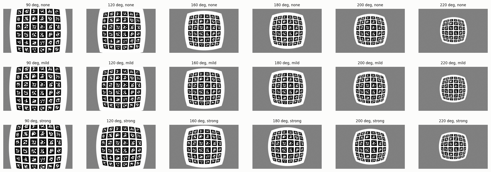
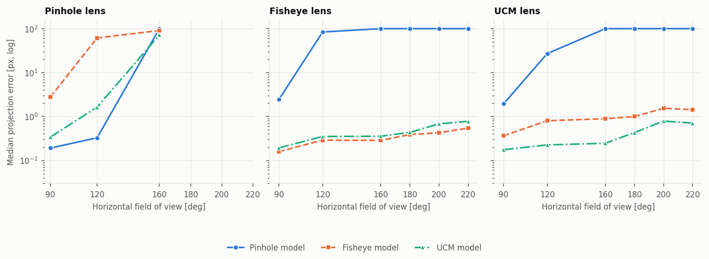

========================================================================
Camera calibration accuracy report
========================================================================

Corners of an AprilGrid, a checkerboard and a ChArUco board are detected in
simulated images of cameras with horizontal fields of view of
90, 120, 160, 180, 200, 220 degrees and different amounts of distortion,
and calibrated with ``CalibCamera``. The result is compared with the ground
truth camera. Every dataset is calibrated with all three camera models, to see
which model fits best.

Setup
=====

.. list-table::
   :header-rows: 1
   :align: center
   :width: 80%
   :widths: 40 60

   * - Setting
     - Value
   * - Resolution
     - 752x480
   * - Principal point offset
     - (+4.0, -3.0) px
   * - fy / fx
     - 1.004
   * - Views per camera and target
     - 80, random poses
   * - Distance to board
     - 90 deg: 0.5-1.5 m, 120 deg: 0.4-1.2 m, 160 deg: 0.3-0.8 m, 180 deg: 0.25-0.6 m, 200 deg: 0.2-0.5 m, 220 deg: 0.2-0.45 m
   * - Tilt
     - 0 - 60 deg
   * - Image
     - blur sigma 0.8 px, noise sigma 2.0 levels
   * - Corner refinement
     - cv::cornerSubPix for checkerboard, ChArUco
   * - Corners dropped beyond
     - 85 deg off the axis (105 deg for KannalaBrandt4 and UnifiedCameraModel cameras above 180 deg)
   * - Seed
     - 42

Simulated lenses, with three distortion levels each (none, mild, strong). The
pinhole lens does not exist at 180 degrees or more. Every lens is calibrated with its
own model and with the other two.

- **BrownConrady4**: pinhole with radial-tangential distortion, -3 % (mild) and
  -12 % (strong) radial distortion at the horizontal image edge.
- **KannalaBrandt4**: equidistant fisheye, ``k1..k4`` = [-0.005, 0.001, 0.0, 0.0]
  (mild) and [-0.03, 0.01, -0.002, 0.0002] (strong).
- **UnifiedCameraModel** (UCM): sphere projection with xi = 0.9
  and the distortion of the pinhole lens.

Targets, all with the detectors of ``lib/calib``:

- **AprilGrid**: 6x6 tags of 80 mm, detected with ``kaess`` and ``olsen``.
- **Checkerboard**: 9x8 squares of 70 mm. Its detector needs the whole board in
  the image, so only poses where the whole board is visible are used.
- **ChArUco**: 9x8 squares of 70 mm, 56 mm markers. It can be partly visible.

BrownConrady4 projects through the plane ``z = 1``, so it cannot use corners 90
degrees or more off the optical axis. KannalaBrandt4 and UnifiedCameraModel can,
but the same limit (``poses.max_theta``) is applied to all models so that they
are fitted to the same corners.

.. figure:: targets.png
   :width: 80%
   :align: center

   The calibration targets.

Camera views
============

A view of the board, looking straight at it, for each camera.

.. figure:: camera_views_BrownConrady4.png
   :width: 80%
   :align: center

   Pinhole + radial-tangential (BrownConrady4): rows are distortion levels, columns are fields of view.

.. figure:: camera_views_KannalaBrandt4.png
   :width: 80%
   :align: center

   Equidistant fisheye (KannalaBrandt4): rows are distortion levels, columns are fields of view.

   Sphere projection (UnifiedCameraModel): rows are distortion levels, columns are fields of view.

Calibration data
================

Detected corners (green) in three views of a 120 degree fisheye camera with strong distortion, and over all views (mild distortion).

.. figure:: calibration_views.png
   :width: 80%
   :align: center

   Three calibration views per target.

.. figure:: coverage.png
   :width: 80%
   :align: center

   Detected corners over the image, all views.

Results
=======

The **projection error** compares the estimated and the ground truth camera:
rays over the image are projected with both and the pixel difference is
measured (rms and max). A camera is *recovered* when the rms is at most
0.5 px. The best result of each row or column is in **bold**.

Target ranking
--------------

Targets ranked by their mean rank over all simulated cameras (1 = lowest projection error of the four, default initial guess).

.. list-table::
   :header-rows: 1
   :align: center
   :width: 80%

   * - Rank
     - Target
     - Mean rank per camera
     - Median error [px]
     - Recovered (<= 0.5 px)
     - Lowest error for cameras
   * - **1 (best)**
     - **Checkerboard**
     - **1.33**
     - **0.09**
     - **41 / 45**
     - **31**
   * - 2
     - ChArUco
     - 2.33
     - 0.17
     - **41 / 45**
     - 13
   * - 3
     - AprilGrid (olsen)
     - 3.02
     - 0.50
     - 22 / 45
     - 1
   * - 4
     - AprilGrid (kaess)
     - 3.31
     - 0.50
     - 21 / 45
     - 2

- **Checkerboard is the most accurate**, followed by ChArUco, AprilGrid (olsen), AprilGrid (kaess).

The best target for every camera model and field of view, by the mean projection error over the three distortion levels:

Pinhole
~~~~~~~

.. list-table::
   :header-rows: 1
   :align: center
   :width: 80%

   * - FOV [deg]
     - Best target
     - Mean error [px]
     - Second
     - Mean error [px]
   * - 90
     - **Checkerboard**
     - 0.06
     - AprilGrid (kaess)
     - 0.12
   * - 120
     - **Checkerboard**
     - 0.08
     - AprilGrid (kaess)
     - 0.15
   * - 160
     - **Checkerboard**
     - 4.65
     - -
     - -

Fisheye
~~~~~~~

.. list-table::
   :header-rows: 1
   :align: center
   :width: 80%

   * - FOV [deg]
     - Best target
     - Mean error [px]
     - Second
     - Mean error [px]
   * - 90
     - **Checkerboard**
     - 0.05
     - ChArUco
     - 0.17
   * - 120
     - **Checkerboard**
     - 0.15
     - ChArUco
     - 0.19
   * - 160
     - **Checkerboard**
     - 0.06
     - ChArUco
     - 0.12
   * - 180
     - **ChArUco**
     - 0.10
     - Checkerboard
     - 0.11
   * - 200
     - **ChArUco**
     - 0.09
     - Checkerboard
     - 0.09
   * - 220
     - **ChArUco**
     - 0.12
     - Checkerboard
     - 0.21

UCM
~~~

.. list-table::
   :header-rows: 1
   :align: center
   :width: 80%

   * - FOV [deg]
     - Best target
     - Mean error [px]
     - Second
     - Mean error [px]
   * - 90
     - **Checkerboard**
     - 0.07
     - AprilGrid (olsen)
     - 0.18
   * - 120
     - **Checkerboard**
     - 0.08
     - AprilGrid (olsen)
     - 0.20
   * - 160
     - **Checkerboard**
     - 0.07
     - ChArUco
     - 0.18
   * - 180
     - **ChArUco**
     - 0.20
     - Checkerboard
     - 0.24
   * - 200
     - **ChArUco**
     - 0.27
     - Checkerboard
     - 0.38
   * - 220
     - **ChArUco**
     - 0.11
     - Checkerboard
     - 0.42

Quick summary
-------------

Default initial guess. Errors are medians over the cameras that converged.

.. list-table::
   :header-rows: 1
   :align: center
   :width: 80%

   * - Target
     - Pinhole 90-120 deg: median error [px]
     - Fisheye: median error [px]
     - UCM: median error [px]
     - Cameras recovered (<= 0.5 px)
     - Lowest error for cameras
     - Principal point: median error [px]
   * - AprilGrid (kaess)
     - 0.13
     - 0.59
     - 0.56
     - 21 / 45
     - 2
     - 0.06
   * - AprilGrid (olsen)
     - 0.47
     - 0.52
     - 0.47
     - 22 / 45
     - 1
     - 0.11
   * - Checkerboard
     - **0.07**
     - **0.07**
     - **0.15**
     - **41 / 45**
     - **31**
     - **0.05**
   * - ChArUco
     - 0.45
     - 0.14
     - 0.23
     - **41 / 45**
     - 13
     - 0.14

- **Best:** Checkerboard, lowest error for 31 of 45 cameras, 41 of 45 recovered.

- **Fisheye and UCM cameras:** every fisheye and UCM camera converges, median error 0.07 - 0.59 px, up to 220 degrees.

- **Pinhole at 160 degrees:** 4 of 12 calibrations converge from the default initial guess, 12 from a guess near the truth, so most failures are the initialisation, not the model.

- **Reprojection error is not accuracy:** BrownConrady4 at 160 degrees (AprilGrid (olsen)) reports 0.67 px but is off by 17.0 px.

Best camera model by field of view
----------------------------------

Every dataset is calibrated with all three models from the default initial guess. The error is the median projection error over the lens types, targets and distortion levels, where a calibration that failed counts as 100 px.

.. list-table::
   :header-rows: 1
   :align: center
   :width: 80%

   * - FOV [deg]
     - BrownConrady4
     - KannalaBrandt4
     - UnifiedCameraModel
     - Best
     - Converged [%] Pinhole
     - Converged [%] Fisheye
     - Converged [%] UCM
   * - 90
     - 1.81
     - 0.26
     - **0.22**
     - **UnifiedCameraModel**
     - 100
     - 100
     - 100
   * - 120
     - 27.01
     - 0.80
     - **0.34**
     - **UnifiedCameraModel**
     - 94
     - 97
     - 100
   * - 160
     - >100
     - 0.89
     - **0.48**
     - **UnifiedCameraModel**
     - 11
     - 83
     - 83
   * - 180
     - >100
     - 0.65
     - **0.43**
     - **UnifiedCameraModel**
     - 0
     - 100
     - 100
   * - 200
     - >100
     - **0.70**
     - **0.70**
     - **UnifiedCameraModel**
     - 0
     - 100
     - 100
   * - 220
     - >100
     - 0.86
     - **0.77**
     - **UnifiedCameraModel**
     - 0
     - 100
     - 100

- **Best model:** UnifiedCameraModel at 90 degrees, UnifiedCameraModel at 120 degrees, UnifiedCameraModel at 160 degrees, UnifiedCameraModel at 180 degrees, UnifiedCameraModel at 200 degrees, UnifiedCameraModel at 220 degrees.

- **BrownConrady4:** fits a pinhole lens up to 120 degrees, but not a fisheye or UCM lens, with a median error of 2.32 px already at 90 degrees.

- **Fisheye against UCM:** on a fisheye lens the UnifiedCameraModel reaches a median error of 0.34 px (KannalaBrandt4: 0.20 px), on a UnifiedCameraModel lens the KannalaBrandt4 reaches 0.98 px (UnifiedCameraModel: 0.26 px).

   Median projection error of every camera model, for every lens type, by field of view.

By lens type:

Pinhole
~~~~~~~

.. list-table::
   :header-rows: 1
   :align: center
   :width: 80%

   * - FOV [deg]
     - BrownConrady4
     - KannalaBrandt4
     - UnifiedCameraModel
   * - 90
     - **0.19**
     - 2.78
     - 0.34
   * - 120
     - **0.33**
     - 61.44
     - 1.63
   * - 160
     - >100
     - 90.69
     - **71.83**

Fisheye
~~~~~~~

.. list-table::
   :header-rows: 1
   :align: center
   :width: 80%

   * - FOV [deg]
     - BrownConrady4
     - KannalaBrandt4
     - UnifiedCameraModel
   * - 90
     - 2.44
     - **0.16**
     - 0.19
   * - 120
     - 83.77
     - **0.29**
     - 0.35
   * - 160
     - >100
     - **0.29**
     - 0.36
   * - 180
     - >100
     - **0.39**
     - 0.43
   * - 200
     - >100
     - **0.43**
     - 0.68
   * - 220
     - >100
     - **0.55**
     - 0.77

UCM
~~~

.. list-table::
   :header-rows: 1
   :align: center
   :width: 80%

   * - FOV [deg]
     - BrownConrady4
     - KannalaBrandt4
     - UnifiedCameraModel
   * - 90
     - 1.95
     - 0.36
     - **0.18**
   * - 120
     - 27.01
     - 0.80
     - **0.23**
   * - 160
     - >100
     - 0.89
     - **0.25**
   * - 180
     - >100
     - 1.00
     - **0.43**
   * - 200
     - >100
     - 1.54
     - **0.79**
   * - 220
     - >100
     - 1.43
     - **0.71**

Parameter errors
----------------

Median over the cameras that converged. ``fx`` is a relative error, the principal point ``cx, cy`` an absolute one.

Default initial guess
~~~~~~~~~~~~~~~~~~~~~

.. list-table::
   :header-rows: 1
   :align: center
   :width: 80%

   * - Model
     - Target
     - fx error [%]
     - cx error [px]
     - cy error [px]
     - Reproj. rmse [px]
     - Converged
   * - BrownConrady4
     - AprilGrid (kaess)
     - **0.01**
     - **0.03**
     - **0.01**
     - 0.081
     - 6 / 9
   * - BrownConrady4
     - AprilGrid (olsen)
     - 0.10
     - 0.04
     - 0.07
     - 0.181
     - 7 / 9
   * - BrownConrady4
     - Checkerboard
     - **0.01**
     - **0.03**
     - 0.05
     - **0.073**
     - **9 / 9**
   * - BrownConrady4
     - ChArUco
     - 0.03
     - 0.17
     - 0.24
     - 0.213
     - 6 / 9
   * - KannalaBrandt4
     - AprilGrid (kaess)
     - 0.37
     - 0.04
     - **0.03**
     - 0.133
     - **18 / 18**
   * - KannalaBrandt4
     - AprilGrid (olsen)
     - 0.35
     - 0.11
     - 0.04
     - 0.184
     - **18 / 18**
   * - KannalaBrandt4
     - Checkerboard
     - 0.04
     - **0.02**
     - **0.03**
     - **0.079**
     - **18 / 18**
   * - KannalaBrandt4
     - ChArUco
     - **0.03**
     - 0.09
     - 0.04
     - 0.227
     - **18 / 18**
   * - UnifiedCameraModel
     - AprilGrid (kaess)
     - **8.02**
     - 0.07
     - **0.03**
     - 0.116
     - **18 / 18**
   * - UnifiedCameraModel
     - AprilGrid (olsen)
     - 8.83
     - 0.05
     - 0.08
     - 0.183
     - **18 / 18**
   * - UnifiedCameraModel
     - Checkerboard
     - 9.98
     - **0.04**
     - **0.03**
     - **0.079**
     - **18 / 18**
   * - UnifiedCameraModel
     - ChArUco
     - 8.42
     - 0.08
     - 0.11
     - 0.228
     - **18 / 18**

Initial guess near the ground truth
~~~~~~~~~~~~~~~~~~~~~~~~~~~~~~~~~~~

.. list-table::
   :header-rows: 1
   :align: center
   :width: 80%

   * - Model
     - Target
     - fx error [%]
     - cx error [px]
     - cy error [px]
     - Reproj. rmse [px]
     - Converged
   * - BrownConrady4
     - AprilGrid (kaess)
     - 0.03
     - 0.05
     - **0.03**
     - 0.089
     - **9 / 9**
   * - BrownConrady4
     - AprilGrid (olsen)
     - 0.07
     - 0.21
     - 0.05
     - 0.203
     - **9 / 9**
   * - BrownConrady4
     - Checkerboard
     - **0.01**
     - **0.03**
     - 0.05
     - **0.073**
     - **9 / 9**
   * - BrownConrady4
     - ChArUco
     - 0.04
     - 0.21
     - 0.29
     - 0.238
     - **9 / 9**
   * - KannalaBrandt4
     - AprilGrid (kaess)
     - 0.37
     - 0.04
     - **0.03**
     - 0.133
     - **18 / 18**
   * - KannalaBrandt4
     - AprilGrid (olsen)
     - 0.35
     - 0.11
     - **0.03**
     - 0.184
     - **18 / 18**
   * - KannalaBrandt4
     - Checkerboard
     - 0.04
     - **0.02**
     - **0.03**
     - **0.079**
     - **18 / 18**
   * - KannalaBrandt4
     - ChArUco
     - **0.03**
     - 0.09
     - 0.04
     - 0.227
     - **18 / 18**
   * - UnifiedCameraModel
     - AprilGrid (kaess)
     - 0.99
     - 0.06
     - **0.02**
     - 0.115
     - **18 / 18**
   * - UnifiedCameraModel
     - AprilGrid (olsen)
     - 1.58
     - 0.08
     - 0.09
     - 0.182
     - **18 / 18**
   * - UnifiedCameraModel
     - Checkerboard
     - 0.99
     - **0.04**
     - 0.03
     - **0.078**
     - **18 / 18**
   * - UnifiedCameraModel
     - ChArUco
     - **0.92**
     - 0.06
     - 0.11
     - 0.228
     - **18 / 18**

Default initial guess
---------------------

.. figure:: model_error_default.png
   :width: 80%
   :align: center

   Projection error (rms) by field of view. Crosses mark calibrations that diverged or failed.

BrownConrady4
~~~~~~~~~~~~~

.. list-table::
   :header-rows: 1
   :align: center
   :width: 80%

   * - Distortion
     - FOV [deg]
     - AprilGrid (kaess)
     - AprilGrid (olsen)
     - Checkerboard
     - ChArUco
   * - none
     - 90
     - 0.19
     - 0.44
     - **0.05**
     - 0.41
   * - none
     - 120
     - 0.24
     - 0.88
     - **0.11**
     - 0.48
   * - none
     - 160
     - >100
     - >100
     - **3.53**
     - >100
   * - none
     - 180
     - n/a
     - n/a
     - n/a
     - n/a
   * - none
     - 200
     - n/a
     - n/a
     - n/a
     - n/a
   * - none
     - 220
     - n/a
     - n/a
     - n/a
     - n/a
   * - mild
     - 90
     - 0.11
     - 0.27
     - **0.07**
     - 0.34
   * - mild
     - 120
     - 0.15
     - 0.50
     - **0.04**
     - 0.49
   * - mild
     - 160
     - >100
     - >100
     - **1.46**
     - >100
   * - mild
     - 180
     - n/a
     - n/a
     - n/a
     - n/a
   * - mild
     - 200
     - n/a
     - n/a
     - n/a
     - n/a
   * - mild
     - 220
     - n/a
     - n/a
     - n/a
     - n/a
   * - strong
     - 90
     - **0.05**
     - 0.19
     - 0.06
     - 0.66
   * - strong
     - 120
     - **0.07**
     - 0.53
     - 0.08
     - 0.42
   * - strong
     - 160
     - >100
     - 16.98
     - **8.95**
     - >100
   * - strong
     - 180
     - n/a
     - n/a
     - n/a
     - n/a
   * - strong
     - 200
     - n/a
     - n/a
     - n/a
     - n/a
   * - strong
     - 220
     - n/a
     - n/a
     - n/a
     - n/a

KannalaBrandt4
~~~~~~~~~~~~~~

.. list-table::
   :header-rows: 1
   :align: center
   :width: 80%

   * - Distortion
     - FOV [deg]
     - AprilGrid (kaess)
     - AprilGrid (olsen)
     - Checkerboard
     - ChArUco
   * - none
     - 90
     - 0.20
     - 0.22
     - **0.06**
     - 0.16
   * - none
     - 120
     - 0.34
     - 0.28
     - **0.07**
     - 0.20
   * - none
     - 160
     - 0.51
     - 0.43
     - **0.05**
     - 0.14
   * - none
     - 180
     - 0.70
     - 0.61
     - **0.04**
     - 0.05
   * - none
     - 200
     - 0.67
     - 0.69
     - 0.18
     - **0.11**
   * - none
     - 220
     - 0.77
     - 0.86
     - 0.18
     - **0.13**
   * - mild
     - 90
     - 0.20
     - 0.16
     - **0.05**
     - 0.20
   * - mild
     - 120
     - 0.34
     - 0.30
     - **0.07**
     - 0.24
   * - mild
     - 160
     - 0.51
     - 0.44
     - **0.05**
     - 0.14
   * - mild
     - 180
     - 0.66
     - 0.61
     - **0.11**
     - 0.14
   * - mild
     - 200
     - 0.70
     - 0.70
     - **0.05**
     - 0.11
   * - mild
     - 220
     - 0.80
     - 0.85
     - 0.11
     - **0.09**
   * - strong
     - 90
     - 0.22
     - 0.16
     - **0.04**
     - 0.16
   * - strong
     - 120
     - 0.36
     - 0.31
     - 0.32
     - **0.14**
   * - strong
     - 160
     - 0.51
     - 0.44
     - **0.09**
     - **0.09**
   * - strong
     - 180
     - 0.68
     - 0.63
     - 0.17
     - **0.10**
   * - strong
     - 200
     - 0.72
     - 0.70
     - **0.05**
     - **0.05**
   * - strong
     - 220
     - 0.78
     - 0.86
     - 0.33
     - **0.14**

UnifiedCameraModel
~~~~~~~~~~~~~~~~~~

.. list-table::
   :header-rows: 1
   :align: center
   :width: 80%

   * - Distortion
     - FOV [deg]
     - AprilGrid (kaess)
     - AprilGrid (olsen)
     - Checkerboard
     - ChArUco
   * - none
     - 90
     - 0.15
     - **0.07**
     - 0.10
     - 0.27
   * - none
     - 120
     - 0.25
     - 0.15
     - **0.12**
     - 0.20
   * - none
     - 160
     - 0.45
     - 0.32
     - **0.07**
     - 0.13
   * - none
     - 180
     - 0.67
     - 0.56
     - **0.19**
     - 0.23
   * - none
     - 200
     - 0.97
     - 0.90
     - **0.21**
     - 0.23
   * - none
     - 220
     - 0.97
     - 0.97
     - 0.49
     - **0.12**
   * - mild
     - 90
     - 0.18
     - 0.26
     - **0.08**
     - 0.45
   * - mild
     - 120
     - 0.27
     - 0.19
     - **0.09**
     - 0.25
   * - mild
     - 160
     - 0.44
     - 0.24
     - **0.06**
     - 0.25
   * - mild
     - 180
     - 0.63
     - 0.57
     - 0.27
     - **0.08**
   * - mild
     - 200
     - 1.14
     - 0.87
     - **0.23**
     - 0.24
   * - mild
     - 220
     - 0.95
     - 0.93
     - 0.43
     - **0.08**
   * - strong
     - 90
     - 0.26
     - 0.21
     - **0.04**
     - 0.17
   * - strong
     - 120
     - 0.34
     - 0.25
     - **0.04**
     - 0.34
   * - strong
     - 160
     - 0.50
     - 0.37
     - **0.07**
     - 0.17
   * - strong
     - 180
     - 0.67
     - 0.62
     - **0.27**
     - 0.30
   * - strong
     - 200
     - 1.15
     - 0.87
     - 0.70
     - **0.33**
   * - strong
     - 220
     - 1.00
     - 0.94
     - 0.33
     - **0.13**

Initial guess near the ground truth
-----------------------------------

.. figure:: model_error_near_truth.png
   :width: 80%
   :align: center

   Projection error (rms) by field of view. Crosses mark calibrations that diverged or failed.

BrownConrady4
~~~~~~~~~~~~~

.. list-table::
   :header-rows: 1
   :align: center
   :width: 80%

   * - Distortion
     - FOV [deg]
     - AprilGrid (kaess)
     - AprilGrid (olsen)
     - Checkerboard
     - ChArUco
   * - none
     - 90
     - 0.17
     - 0.51
     - **0.05**
     - 0.41
   * - none
     - 120
     - 0.29
     - 0.40
     - **0.11**
     - 0.48
   * - none
     - 160
     - **0.28**
     - 1.78
     - 3.53
     - 4.78
   * - none
     - 180
     - n/a
     - n/a
     - n/a
     - n/a
   * - none
     - 200
     - n/a
     - n/a
     - n/a
     - n/a
   * - none
     - 220
     - n/a
     - n/a
     - n/a
     - n/a
   * - mild
     - 90
     - 0.11
     - 0.61
     - **0.07**
     - 0.34
   * - mild
     - 120
     - 0.15
     - 0.36
     - **0.04**
     - 0.49
   * - mild
     - 160
     - **0.44**
     - 1.63
     - 1.46
     - 4.35
   * - mild
     - 180
     - n/a
     - n/a
     - n/a
     - n/a
   * - mild
     - 200
     - n/a
     - n/a
     - n/a
     - n/a
   * - mild
     - 220
     - n/a
     - n/a
     - n/a
     - n/a
   * - strong
     - 90
     - **0.05**
     - 0.73
     - 0.06
     - 0.66
   * - strong
     - 120
     - 0.21
     - 0.50
     - **0.08**
     - 0.42
   * - strong
     - 160
     - **1.51**
     - 3.19
     - 8.95
     - 3.61
   * - strong
     - 180
     - n/a
     - n/a
     - n/a
     - n/a
   * - strong
     - 200
     - n/a
     - n/a
     - n/a
     - n/a
   * - strong
     - 220
     - n/a
     - n/a
     - n/a
     - n/a

KannalaBrandt4
~~~~~~~~~~~~~~

.. list-table::
   :header-rows: 1
   :align: center
   :width: 80%

   * - Distortion
     - FOV [deg]
     - AprilGrid (kaess)
     - AprilGrid (olsen)
     - Checkerboard
     - ChArUco
   * - none
     - 90
     - 0.21
     - 0.26
     - **0.06**
     - 0.16
   * - none
     - 120
     - 0.34
     - 0.44
     - **0.07**
     - 0.20
   * - none
     - 160
     - 0.51
     - 0.45
     - **0.05**
     - 0.14
   * - none
     - 180
     - 0.70
     - 0.61
     - **0.04**
     - 0.05
   * - none
     - 200
     - 0.67
     - 0.68
     - 0.18
     - **0.11**
   * - none
     - 220
     - 0.76
     - 0.86
     - 0.18
     - **0.13**
   * - mild
     - 90
     - 0.21
     - 0.19
     - **0.05**
     - 0.20
   * - mild
     - 120
     - 0.34
     - 0.34
     - **0.07**
     - 0.24
   * - mild
     - 160
     - 0.51
     - 0.44
     - **0.05**
     - 0.14
   * - mild
     - 180
     - 0.66
     - 0.61
     - **0.11**
     - 0.14
   * - mild
     - 200
     - 0.70
     - 0.70
     - **0.05**
     - 0.11
   * - mild
     - 220
     - 0.80
     - 0.85
     - 0.11
     - **0.09**
   * - strong
     - 90
     - 0.22
     - 0.18
     - **0.04**
     - 0.16
   * - strong
     - 120
     - 0.36
     - 0.31
     - 0.32
     - **0.14**
   * - strong
     - 160
     - 0.51
     - 0.44
     - **0.09**
     - **0.09**
   * - strong
     - 180
     - 0.68
     - 0.63
     - 0.17
     - **0.10**
   * - strong
     - 200
     - 0.72
     - 0.70
     - **0.05**
     - **0.05**
   * - strong
     - 220
     - 0.78
     - 0.86
     - 0.33
     - **0.14**

UnifiedCameraModel
~~~~~~~~~~~~~~~~~~

.. list-table::
   :header-rows: 1
   :align: center
   :width: 80%

   * - Distortion
     - FOV [deg]
     - AprilGrid (kaess)
     - AprilGrid (olsen)
     - Checkerboard
     - ChArUco
   * - none
     - 90
     - 0.16
     - 0.21
     - **0.10**
     - 0.26
   * - none
     - 120
     - 0.25
     - 0.17
     - **0.12**
     - 0.20
   * - none
     - 160
     - 0.45
     - 0.33
     - **0.06**
     - 0.13
   * - none
     - 180
     - 0.67
     - 0.55
     - **0.19**
     - 0.22
   * - none
     - 200
     - 0.96
     - 0.87
     - **0.07**
     - 0.17
   * - none
     - 220
     - 0.97
     - 0.97
     - **0.05**
     - 0.14
   * - mild
     - 90
     - 0.18
     - 0.26
     - **0.07**
     - 0.45
   * - mild
     - 120
     - 0.27
     - 0.16
     - **0.08**
     - 0.25
   * - mild
     - 160
     - 0.43
     - 0.18
     - **0.06**
     - 0.24
   * - mild
     - 180
     - 0.62
     - 0.56
     - 0.27
     - **0.11**
   * - mild
     - 200
     - 1.13
     - 0.83
     - **0.06**
     - 0.09
   * - mild
     - 220
     - 0.96
     - 0.92
     - 0.13
     - **0.10**
   * - strong
     - 90
     - 0.26
     - 0.23
     - **0.04**
     - 0.17
   * - strong
     - 120
     - 0.34
     - 0.24
     - **0.04**
     - 0.34
   * - strong
     - 160
     - 0.50
     - 0.34
     - **0.07**
     - 0.17
   * - strong
     - 180
     - 0.66
     - 0.60
     - **0.27**
     - 0.31
   * - strong
     - 200
     - 1.10
     - 0.86
     - 0.18
     - **0.17**
   * - strong
     - 220
     - 0.99
     - 0.94
     - 0.18
     - **0.10**
