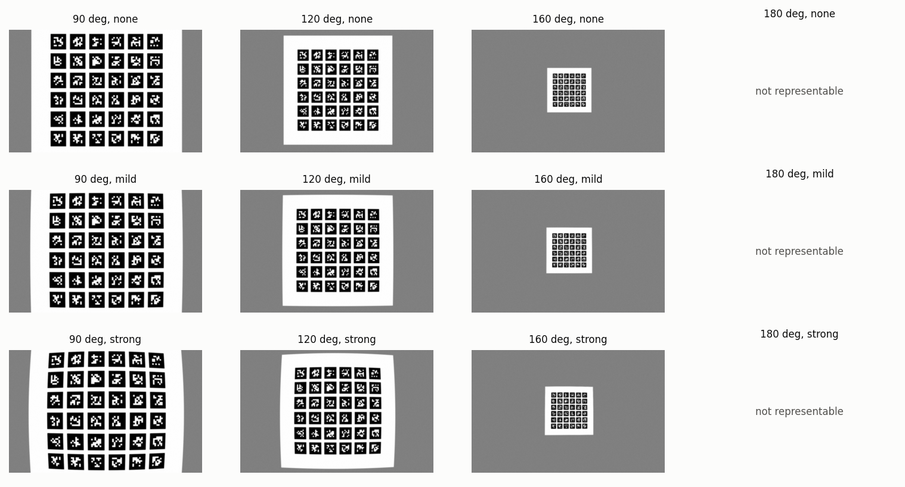
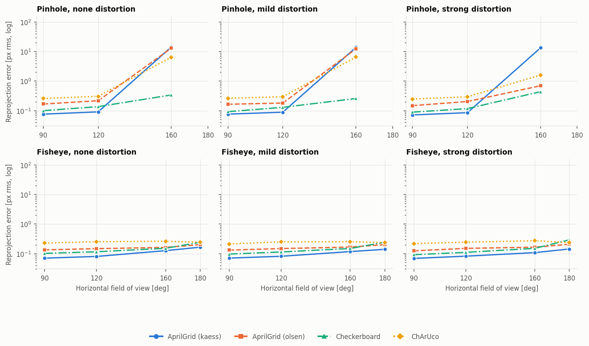
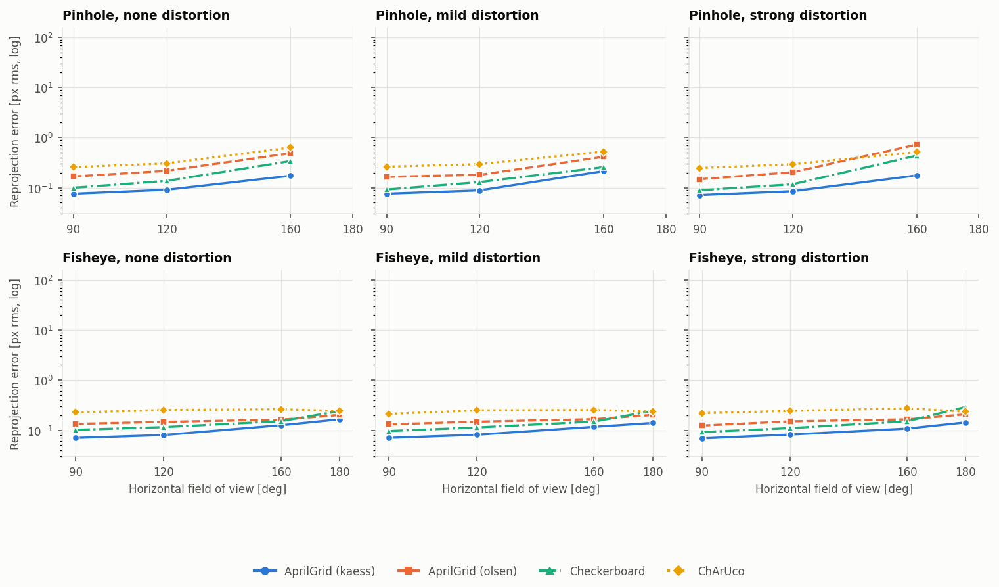

========================================================================
Camera calibration accuracy report
========================================================================

Corners of an AprilGrid, a checkerboard and a ChArUco board are detected in
simulated images from cameras with horizontal fields of view of
90, 120, 160, 180 degrees and with varying amounts of
distortion, and are put through ``CalibCamera``. The recovered camera is
compared against the ground truth camera that rendered the images.

Each camera is simulated with ``80`` views of each target, with
the target placed at random locations across the whole image. The AprilGrid is
detected with both the ``kaess`` and the ``olsen`` detector. Every dataset is
calibrated twice: once from the calibrator's default initial guess, and once
from a guess near the ground truth.

Summary
=======

- **Fisheye (KannalaBrandt4), from the default initial guess:** every camera converged, for every target, up to 180 degrees. Projection error against the ground truth, AprilGrid (kaess): 0.43 px median, 6 of 12 within 0.5 px; AprilGrid (olsen): 0.80 px median, 0 of 12 within 0.5 px; Checkerboard: 0.53 px median, 5 of 12 within 0.5 px; ChArUco: 0.29 px median, 11 of 12 within 0.5 px.

- **Pinhole (BrownConrady4) at 90 and 120 degrees, from the default initial guess:** AprilGrid (kaess): 0.13 px median, 6 of 6 within 0.5 px; AprilGrid (olsen): 0.89 px median, 0 of 6 within 0.5 px; Checkerboard: 0.65 px median, 2 of 6 within 0.5 px; ChArUco: 0.45 px median, 3 of 6 within 0.5 px.

- **Pinhole at 160 degrees:** cameras that converged (projection error below 100 px) from the default initial guess: AprilGrid (kaess) 0 of 3, AprilGrid (olsen) 1 of 3, Checkerboard 3 of 3, ChArUco 1 of 3. From a guess near the ground truth: AprilGrid (kaess) 3 of 3, median 0.4 px, AprilGrid (olsen) 3 of 3, median 1.9 px, Checkerboard 3 of 3, median 7.9 px, ChArUco 3 of 3, median 6.6 px. A camera that converges from the near-truth guess but not from the default one fails because of the initialisation, not the camera model. A pinhole camera cannot represent 180 degrees.

- **Principal point:** mean error in x / y [px] over the converged cameras: AprilGrid (kaess) -0.01 / +0.01; AprilGrid (olsen) +0.50 / +0.54; Checkerboard -0.19 / +0.05; ChArUco +0.23 / +0.10. The olsen corners are offset by about half a pixel in both axes (see the detector experiment), and a calibration absorbs a constant offset into the principal point, which is what the olsen error shows.

- **The reprojection error does not show it:** the mean reprojection error of the calibrator [px] is AprilGrid (kaess) 0.10, AprilGrid (olsen) 0.20, Checkerboard 0.17, ChArUco 0.33. A constant corner offset hardly raises it. The worst case is BrownConrady4 at 160 degrees with strong distortion (AprilGrid (olsen), default initial guess), which reports 0.70 px while its projection error is 20.9 px.

- **Data:** the checkerboard is only detected with the whole board in the image, so it only uses poses where the whole board is visible, and its corners stay close to the image center, where the distortion is weakest (see the coverage figure). The ChArUco board can be partly visible but has fewer corners than the AprilGrid. Mean per camera: AprilGrid (kaess) 80 views and 7,097 corners; AprilGrid (olsen) 80 views and 7,579 corners; Checkerboard 75 views and 4,197 corners; ChArUco 75 views and 2,383 corners.

- **Limits of the camera models:** both models project through the plane ``z = 1``, so rays at or beyond 90 degrees off the optical axis cannot be represented. Corners beyond 85 degrees are dropped, so at 180 degrees the calibration only uses the inner 170 degree cone and the image corners are unused.

Setup
=====

.. list-table::
   :header-rows: 1
   :align: center
   :width: 80%
   :widths: 40 60

   * - Setting
     - Value
   * - Resolution
     - 752x480
   * - Principal point offset
     - (+4.0, -3.0) px from the center
   * - fy / fx
     - 1.004
   * - Views per camera and target
     - 80
   * - Distance to board
     - 90 deg: 0.5-1.5 m, 120 deg: 0.4-1.2 m, 160 deg: 0.3-0.8 m, 180 deg: 0.25-0.6 m
   * - Tilt of the camera about the board
     - 0 - 60 deg
   * - Corners further off the optical axis than
     - 85 deg are dropped
   * - Image
     - blur sigma 0.8 px, noise sigma 2.0 levels
   * - Seed
     - 42

The ground truth cameras are built so that the horizontal image edge, through
the principal point, sees exactly the stated field of view:

- **BrownConrady4**: a pinhole camera with radial-tangential distortion. The
  radial distortion is given as the fraction by which the horizontal image
  edge is displaced, so the levels are comparable across fields of view.
  *none* is 0 %, *mild* is -3 % and *strong* is -12 % with an opposing second
  order term, plus tangential terms.
- **KannalaBrandt4**: an equidistant fisheye camera. *none* is the pure
  equidistant projection and the coefficients ``k1..k4`` of *mild* and
  *strong* are in the table of distortion coefficients below.

A pinhole camera cannot see 180 degrees, so that combination is not
simulated. Projections with the distortion folding the image over are also
rejected before any simulation.

Calibration targets
===================

All targets are detected with the library detectors and calibrated with
``CalibCamera``. The target sizes are set in ``exps/common``.

- **AprilGrid**: 6x6 tags of 80 mm with 25 % spacing, plain (no black squares
  between the tags). Detected with ``kaess`` and ``olsen``, which need
  different tag code tables, so the rendered grid is a different one for each.
- **Checkerboard**: 9x8 squares of 70 mm, 8x7 inner corners. The detector
  needs the whole board in the image, so only poses where the whole board is
  visible are used.
- **ChArUco**: 9x8 squares of 70 mm with 56 mm markers (5x5 dictionary). The
  markers identify the corners, so the board can be partly visible.

The kalibr style grid (black squares between the tags) is shown for reference
only, ``olsen`` detects few of its tags.

.. figure:: targets.png
   :width: 80%
   :align: center

   The calibration targets. The AprilGrid tags are rendered with the tag code table of the ``kaess`` detector.

Camera views
============

The same view of the board, looking straight at it, as seen by each simulated
camera. The board is placed at the closest distance used for that field of
view.

   Pinhole + radial-tangential (BrownConrady4): rows are distortion levels and columns are horizontal fields of view.

.. figure:: camera_views_KannalaBrandt4.png
   :width: 80%
   :align: center

   Equidistant fisheye (KannalaBrandt4): rows are distortion levels and columns are horizontal fields of view.

Calibration data
================

Example calibration views of a 120 degree fisheye camera with strong
distortion, for each target. Detected corners are drawn in green, and corners
that do not match the ground truth in red. Corners further than
85 degrees off the optical axis are dropped, since
``KannalaBrandt4`` and ``BrownConrady4`` project through the plane ``z = 1`` and
cannot represent rays at or beyond 90 degrees.

.. figure:: calibration_views.png
   :width: 80%
   :align: center

   Three calibration views per target.

The detected corners over all views of each camera (mild distortion). The
AprilGrid corners cover most of the image. The checkerboard corners stay near
the center because the whole board has to be visible, and the ChArUco corners
are spread out but fewer. For the 160 degree pinhole camera, which is not
shown, detections are limited to a ring around the image center.

.. figure:: coverage.png
   :width: 80%
   :align: center

   Detected corners over the image, all views.

Views used and corners per camera (default initial guess):

.. list-table::
   :header-rows: 1
   :align: center
   :width: 80%

   * - Model
     - Distortion
     - FOV [deg]
     - AprilGrid (kaess): views / corners
     - AprilGrid (olsen): views / corners
     - Checkerboard: views / corners
     - ChArUco: views / corners
   * - BrownConrady4
     - none
     - 90
     - 80 / 7,564
     - 80 / 7,832
     - 80 / 4,480
     - 79 / 2,547
   * - BrownConrady4
     - none
     - 120
     - 80 / 6,593
     - 80 / 7,415
     - 77 / 4,312
     - 73 / 2,004
   * - BrownConrady4
     - none
     - 160
     - 80 / 3,571
     - 80 / 4,718
     - 61 / 3,416
     - 51 / 704
   * - BrownConrady4
     - none
     - 180
     - n/a
     - n/a
     - n/a
     - n/a
   * - BrownConrady4
     - mild
     - 90
     - 80 / 7,639
     - 80 / 7,871
     - 79 / 4,424
     - 78 / 2,588
   * - BrownConrady4
     - mild
     - 120
     - 80 / 6,676
     - 80 / 7,505
     - 77 / 4,312
     - 75 / 2,082
   * - BrownConrady4
     - mild
     - 160
     - 80 / 3,715
     - 80 / 4,842
     - 62 / 3,472
     - 53 / 754
   * - BrownConrady4
     - mild
     - 180
     - n/a
     - n/a
     - n/a
     - n/a
   * - BrownConrady4
     - strong
     - 90
     - 80 / 7,754
     - 80 / 7,954
     - 78 / 4,368
     - 78 / 2,644
   * - BrownConrady4
     - strong
     - 120
     - 80 / 6,909
     - 80 / 7,620
     - 78 / 4,368
     - 76 / 2,189
   * - BrownConrady4
     - strong
     - 160
     - 80 / 3,861
     - 80 / 5,043
     - 65 / 3,640
     - 59 / 901
   * - BrownConrady4
     - strong
     - 180
     - n/a
     - n/a
     - n/a
     - n/a
   * - KannalaBrandt4
     - none
     - 90
     - 80 / 7,949
     - 80 / 8,109
     - 80 / 4,480
     - 78 / 2,821
   * - KannalaBrandt4
     - none
     - 120
     - 80 / 7,992
     - 80 / 8,269
     - 75 / 4,200
     - 78 / 2,758
   * - KannalaBrandt4
     - none
     - 160
     - 80 / 7,922
     - 80 / 8,226
     - 77 / 4,312
     - 80 / 2,790
   * - KannalaBrandt4
     - none
     - 180
     - 80 / 7,708
     - 80 / 8,141
     - 72 / 4,032
     - 80 / 2,807
   * - KannalaBrandt4
     - mild
     - 90
     - 80 / 7,971
     - 80 / 8,114
     - 80 / 4,480
     - 78 / 2,830
   * - KannalaBrandt4
     - mild
     - 120
     - 80 / 7,987
     - 80 / 8,267
     - 76 / 4,256
     - 78 / 2,800
   * - KannalaBrandt4
     - mild
     - 160
     - 80 / 7,894
     - 80 / 8,247
     - 77 / 4,312
     - 80 / 2,763
   * - KannalaBrandt4
     - mild
     - 180
     - 80 / 7,679
     - 80 / 8,154
     - 72 / 4,032
     - 80 / 2,812
   * - KannalaBrandt4
     - strong
     - 90
     - 80 / 7,982
     - 80 / 8,111
     - 80 / 4,480
     - 79 / 2,849
   * - KannalaBrandt4
     - strong
     - 120
     - 80 / 8,034
     - 80 / 8,306
     - 76 / 4,256
     - 78 / 2,783
   * - KannalaBrandt4
     - strong
     - 160
     - 80 / 7,894
     - 80 / 8,238
     - 78 / 4,368
     - 80 / 2,808
   * - KannalaBrandt4
     - strong
     - 180
     - 80 / 7,739
     - 80 / 8,185
     - 74 / 4,144
     - 80 / 2,817

Results
=======

Parameters of different camera models are strongly correlated, in particular
the focal length and distortion coefficients, so comparing coefficients is not
a good measure of how well a camera was recovered. The main measure is the
**projection error**: rays over the image (every 8 pixels, up to
85 degrees off the axis) are projected by the
ground truth and the estimated camera, and the pixel difference is measured
(rms and max). A camera is *recovered* when the rms is at most 0.5 px.

In the tables, the best target of each row or column is in **bold**: the lowest
error, or the most recovered cameras. A calibration that failed or diverged
never counts as the best.

Cameras recovered (rms projection error <= 0.5 px), out of the simulated ones:

.. list-table::
   :header-rows: 1
   :align: center
   :width: 80%

   * - Initial guess
     - Model
     - Target
     - Recovered
   * - default
     - BrownConrady4
     - AprilGrid (kaess)
     - **6 / 9**
   * - default
     - BrownConrady4
     - AprilGrid (olsen)
     - 0 / 9
   * - default
     - BrownConrady4
     - Checkerboard
     - 2 / 9
   * - default
     - BrownConrady4
     - ChArUco
     - 3 / 9
   * - default
     - KannalaBrandt4
     - AprilGrid (kaess)
     - 6 / 12
   * - default
     - KannalaBrandt4
     - AprilGrid (olsen)
     - 0 / 12
   * - default
     - KannalaBrandt4
     - Checkerboard
     - 5 / 12
   * - default
     - KannalaBrandt4
     - ChArUco
     - **11 / 12**
   * - near_truth
     - BrownConrady4
     - AprilGrid (kaess)
     - **8 / 9**
   * - near_truth
     - BrownConrady4
     - AprilGrid (olsen)
     - 0 / 9
   * - near_truth
     - BrownConrady4
     - Checkerboard
     - 2 / 9
   * - near_truth
     - BrownConrady4
     - ChArUco
     - 3 / 9
   * - near_truth
     - KannalaBrandt4
     - AprilGrid (kaess)
     - 6 / 12
   * - near_truth
     - KannalaBrandt4
     - AprilGrid (olsen)
     - 0 / 12
   * - near_truth
     - KannalaBrandt4
     - Checkerboard
     - 5 / 12
   * - near_truth
     - KannalaBrandt4
     - ChArUco
     - **11 / 12**

Parameter errors of the recovered camera, as the median over the cameras that converged (rms projection error below 100 px). The focal length ``fx`` is a relative error and the principal point ``cx, cy`` an absolute one.

.. list-table::
   :header-rows: 1
   :align: center
   :width: 80%

   * - Initial guess
     - Model
     - Target
     - fx error [%]
     - cx error [px]
     - cy error [px]
     - Reproj. rmse [px]
     - Converged
   * - default
     - BrownConrady4
     - AprilGrid (kaess)
     - **0.01**
     - **0.03**
     - **0.01**
     - **0.081**
     - 6 / 9
   * - default
     - BrownConrady4
     - AprilGrid (olsen)
     - 0.10
     - 0.52
     - 0.57
     - 0.181
     - 7 / 9
   * - default
     - BrownConrady4
     - Checkerboard
     - 0.24
     - 0.17
     - 0.06
     - 0.129
     - 9 / 9
   * - default
     - BrownConrady4
     - ChArUco
     - 0.03
     - 0.27
     - 0.27
     - 0.294
     - 7 / 9
   * - default
     - KannalaBrandt4
     - AprilGrid (kaess)
     - 0.24
     - **0.04**
     - **0.02**
     - **0.095**
     - 12 / 12
   * - default
     - KannalaBrandt4
     - AprilGrid (olsen)
     - 0.20
     - 0.55
     - 0.53
     - 0.156
     - 12 / 12
   * - default
     - KannalaBrandt4
     - Checkerboard
     - 0.19
     - 0.21
     - 0.06
     - 0.132
     - 12 / 12
   * - default
     - KannalaBrandt4
     - ChArUco
     - **0.07**
     - 0.22
     - 0.17
     - 0.243
     - 12 / 12
   * - near_truth
     - BrownConrady4
     - AprilGrid (kaess)
     - **0.03**
     - **0.05**
     - **0.03**
     - **0.089**
     - 9 / 9
   * - near_truth
     - BrownConrady4
     - AprilGrid (olsen)
     - 0.07
     - 0.75
     - 0.44
     - 0.204
     - 9 / 9
   * - near_truth
     - BrownConrady4
     - Checkerboard
     - 0.24
     - 0.17
     - 0.06
     - 0.129
     - 9 / 9
   * - near_truth
     - BrownConrady4
     - ChArUco
     - 0.04
     - 0.30
     - 0.26
     - 0.296
     - 9 / 9
   * - near_truth
     - KannalaBrandt4
     - AprilGrid (kaess)
     - 0.24
     - **0.04**
     - **0.03**
     - **0.095**
     - 12 / 12
   * - near_truth
     - KannalaBrandt4
     - AprilGrid (olsen)
     - 0.20
     - 0.56
     - 0.53
     - 0.156
     - 12 / 12
   * - near_truth
     - KannalaBrandt4
     - Checkerboard
     - 0.19
     - 0.21
     - 0.06
     - 0.132
     - 12 / 12
   * - near_truth
     - KannalaBrandt4
     - ChArUco
     - **0.07**
     - 0.22
     - 0.17
     - 0.243
     - 12 / 12

Calibrating from the default initial guess
------------------------------------------

.. figure:: model_error_default.png
   :width: 80%
   :align: center

   Projection error against the ground truth camera, by field of view. Crosses at the top mark cameras where the calibration diverged or failed. Pinhole at 180 degrees is not simulated.

Projection error, rms over the image [px]:

.. list-table::
   :header-rows: 1
   :align: center
   :width: 80%

   * - Model
     - Distortion
     - FOV [deg]
     - AprilGrid (kaess)
     - AprilGrid (olsen)
     - Checkerboard
     - ChArUco
   * - BrownConrady4
     - none
     - 90
     - **0.19**
     - 0.85
     - 0.47
     - 0.50
   * - BrownConrady4
     - none
     - 120
     - **0.24**
     - 1.25
     - 0.88
     - 1.26
   * - BrownConrady4
     - none
     - 160
     - >100
     - >100
     - **7.88**
     - >100
   * - BrownConrady4
     - none
     - 180
     - n/a
     - n/a
     - n/a
     - n/a
   * - BrownConrady4
     - mild
     - 90
     - **0.11**
     - 0.79
     - 0.48
     - 0.39
   * - BrownConrady4
     - mild
     - 120
     - **0.15**
     - 0.93
     - 0.74
     - 0.33
   * - BrownConrady4
     - mild
     - 160
     - >100
     - >100
     - **3.69**
     - >100
   * - BrownConrady4
     - mild
     - 180
     - n/a
     - n/a
     - n/a
     - n/a
   * - BrownConrady4
     - strong
     - 90
     - **0.05**
     - 0.77
     - 0.60
     - 0.30
   * - BrownConrady4
     - strong
     - 120
     - **0.07**
     - 0.98
     - 0.70
     - 0.77
   * - BrownConrady4
     - strong
     - 160
     - >100
     - 20.89
     - **11.07**
     - 94.29
   * - BrownConrady4
     - strong
     - 180
     - n/a
     - n/a
     - n/a
     - n/a
   * - KannalaBrandt4
     - none
     - 90
     - 0.20
     - 0.60
     - 0.75
     - **0.18**
   * - KannalaBrandt4
     - none
     - 120
     - **0.34**
     - 0.93
     - 0.75
     - 0.38
   * - KannalaBrandt4
     - none
     - 160
     - 0.51
     - 0.71
     - 0.46
     - **0.21**
   * - KannalaBrandt4
     - none
     - 180
     - 0.70
     - 0.99
     - 0.27
     - **0.26**
   * - KannalaBrandt4
     - mild
     - 90
     - **0.20**
     - 0.68
     - 0.55
     - 0.43
   * - KannalaBrandt4
     - mild
     - 120
     - **0.34**
     - 0.96
     - 0.72
     - 0.50
   * - KannalaBrandt4
     - mild
     - 160
     - 0.51
     - 0.71
     - 0.45
     - **0.23**
   * - KannalaBrandt4
     - mild
     - 180
     - 0.66
     - 1.00
     - **0.22**
     - 0.31
   * - KannalaBrandt4
     - strong
     - 90
     - **0.22**
     - 0.68
     - 0.54
     - 0.47
   * - KannalaBrandt4
     - strong
     - 120
     - **0.36**
     - 0.89
     - 0.85
     - 0.48
   * - KannalaBrandt4
     - strong
     - 160
     - 0.51
     - 0.72
     - 0.53
     - **0.14**
   * - KannalaBrandt4
     - strong
     - 180
     - 0.68
     - 1.01
     - 0.36
     - **0.27**

Projection error, max over the image [px]:

.. list-table::
   :header-rows: 1
   :align: center
   :width: 80%

   * - Model
     - Distortion
     - FOV [deg]
     - AprilGrid (kaess)
     - AprilGrid (olsen)
     - Checkerboard
     - ChArUco
   * - BrownConrady4
     - none
     - 90
     - **0.52**
     - 1.54
     - 1.12
     - 0.91
   * - BrownConrady4
     - none
     - 120
     - **0.67**
     - 3.27
     - 2.17
     - 3.62
   * - BrownConrady4
     - none
     - 160
     - >100
     - >100
     - **16.71**
     - >100
   * - BrownConrady4
     - none
     - 180
     - n/a
     - n/a
     - n/a
     - n/a
   * - BrownConrady4
     - mild
     - 90
     - **0.34**
     - 1.32
     - 0.98
     - 0.86
   * - BrownConrady4
     - mild
     - 120
     - **0.50**
     - 1.97
     - 1.59
     - 1.79
   * - BrownConrady4
     - mild
     - 160
     - >100
     - >100
     - **16.93**
     - >100
   * - BrownConrady4
     - mild
     - 180
     - n/a
     - n/a
     - n/a
     - n/a
   * - BrownConrady4
     - strong
     - 90
     - **0.07**
     - 1.16
     - 1.35
     - 0.53
   * - BrownConrady4
     - strong
     - 120
     - **0.14**
     - 2.07
     - 1.93
     - 2.25
   * - BrownConrady4
     - strong
     - 160
     - >100
     - 44.48
     - **42.85**
     - >100
   * - BrownConrady4
     - strong
     - 180
     - n/a
     - n/a
     - n/a
     - n/a
   * - KannalaBrandt4
     - none
     - 90
     - 0.40
     - 0.73
     - 1.45
     - **0.23**
   * - KannalaBrandt4
     - none
     - 120
     - **0.50**
     - 1.18
     - 1.50
     - 0.53
   * - KannalaBrandt4
     - none
     - 160
     - 0.75
     - 1.03
     - 0.76
     - **0.33**
   * - KannalaBrandt4
     - none
     - 180
     - 0.87
     - 1.48
     - **0.40**
     - 0.46
   * - KannalaBrandt4
     - mild
     - 90
     - **0.40**
     - 0.80
     - 1.40
     - 0.81
   * - KannalaBrandt4
     - mild
     - 120
     - **0.49**
     - 1.23
     - 1.27
     - 1.14
   * - KannalaBrandt4
     - mild
     - 160
     - 0.75
     - 1.03
     - 0.72
     - **0.34**
   * - KannalaBrandt4
     - mild
     - 180
     - 0.81
     - 1.49
     - **0.32**
     - 0.53
   * - KannalaBrandt4
     - strong
     - 90
     - **0.34**
     - 0.84
     - 1.30
     - 0.90
   * - KannalaBrandt4
     - strong
     - 120
     - 0.60
     - 1.17
     - 5.33
     - **0.58**
   * - KannalaBrandt4
     - strong
     - 160
     - 0.72
     - 1.05
     - 1.07
     - **0.29**
   * - KannalaBrandt4
     - strong
     - 180
     - 0.85
     - 1.51
     - 0.74
     - **0.46**

   Reprojection error of the calibrator, by field of view. A low reprojection error does not mean the camera was recovered, see the projection error.

Calibrating from an initial guess near the ground truth
-------------------------------------------------------

.. figure:: model_error_near_truth.png
   :width: 80%
   :align: center

   Projection error against the ground truth camera, by field of view. Crosses at the top mark cameras where the calibration diverged or failed. Pinhole at 180 degrees is not simulated.

Projection error, rms over the image [px]:

.. list-table::
   :header-rows: 1
   :align: center
   :width: 80%

   * - Model
     - Distortion
     - FOV [deg]
     - AprilGrid (kaess)
     - AprilGrid (olsen)
     - Checkerboard
     - ChArUco
   * - BrownConrady4
     - none
     - 90
     - **0.17**
     - 1.06
     - 0.47
     - 0.50
   * - BrownConrady4
     - none
     - 120
     - **0.29**
     - 0.80
     - 0.88
     - 1.26
   * - BrownConrady4
     - none
     - 160
     - **0.28**
     - 1.84
     - 7.88
     - 6.57
   * - BrownConrady4
     - none
     - 180
     - n/a
     - n/a
     - n/a
     - n/a
   * - BrownConrady4
     - mild
     - 90
     - **0.11**
     - 1.13
     - 0.48
     - 0.39
   * - BrownConrady4
     - mild
     - 120
     - **0.15**
     - 0.82
     - 0.74
     - 0.33
   * - BrownConrady4
     - mild
     - 160
     - **0.44**
     - 1.88
     - 3.69
     - 9.73
   * - BrownConrady4
     - mild
     - 180
     - n/a
     - n/a
     - n/a
     - n/a
   * - BrownConrady4
     - strong
     - 90
     - **0.05**
     - 1.20
     - 0.60
     - 0.30
   * - BrownConrady4
     - strong
     - 120
     - **0.21**
     - 1.02
     - 0.70
     - 0.77
   * - BrownConrady4
     - strong
     - 160
     - **1.51**
     - 5.38
     - 11.07
     - 4.75
   * - BrownConrady4
     - strong
     - 180
     - n/a
     - n/a
     - n/a
     - n/a
   * - KannalaBrandt4
     - none
     - 90
     - 0.21
     - 0.70
     - 0.75
     - **0.18**
   * - KannalaBrandt4
     - none
     - 120
     - **0.34**
     - 0.96
     - 0.75
     - 0.38
   * - KannalaBrandt4
     - none
     - 160
     - 0.51
     - 0.70
     - 0.46
     - **0.21**
   * - KannalaBrandt4
     - none
     - 180
     - 0.70
     - 0.99
     - 0.27
     - **0.26**
   * - KannalaBrandt4
     - mild
     - 90
     - **0.21**
     - 0.71
     - 0.55
     - 0.43
   * - KannalaBrandt4
     - mild
     - 120
     - **0.34**
     - 0.96
     - 0.72
     - 0.50
   * - KannalaBrandt4
     - mild
     - 160
     - 0.51
     - 0.71
     - 0.45
     - **0.23**
   * - KannalaBrandt4
     - mild
     - 180
     - 0.66
     - 1.00
     - **0.22**
     - 0.31
   * - KannalaBrandt4
     - strong
     - 90
     - **0.22**
     - 0.73
     - 0.54
     - 0.47
   * - KannalaBrandt4
     - strong
     - 120
     - **0.36**
     - 0.89
     - 0.85
     - 0.48
   * - KannalaBrandt4
     - strong
     - 160
     - 0.51
     - 0.72
     - 0.53
     - **0.14**
   * - KannalaBrandt4
     - strong
     - 180
     - 0.68
     - 1.01
     - 0.36
     - **0.27**

Projection error, max over the image [px]:

.. list-table::
   :header-rows: 1
   :align: center
   :width: 80%

   * - Model
     - Distortion
     - FOV [deg]
     - AprilGrid (kaess)
     - AprilGrid (olsen)
     - Checkerboard
     - ChArUco
   * - BrownConrady4
     - none
     - 90
     - **0.43**
     - 2.06
     - 1.12
     - 0.91
   * - BrownConrady4
     - none
     - 120
     - **0.92**
     - 1.83
     - 2.17
     - 3.62
   * - BrownConrady4
     - none
     - 160
     - **0.87**
     - 3.74
     - 16.71
     - 30.15
   * - BrownConrady4
     - none
     - 180
     - n/a
     - n/a
     - n/a
     - n/a
   * - BrownConrady4
     - mild
     - 90
     - **0.34**
     - 1.81
     - 0.98
     - 0.86
   * - BrownConrady4
     - mild
     - 120
     - **0.49**
     - 1.55
     - 1.59
     - 1.79
   * - BrownConrady4
     - mild
     - 160
     - **1.19**
     - 5.86
     - 16.93
     - 29.10
   * - BrownConrady4
     - mild
     - 180
     - n/a
     - n/a
     - n/a
     - n/a
   * - BrownConrady4
     - strong
     - 90
     - **0.07**
     - 1.73
     - 1.35
     - 0.53
   * - BrownConrady4
     - strong
     - 120
     - **0.45**
     - 1.97
     - 1.93
     - 2.25
   * - BrownConrady4
     - strong
     - 160
     - **4.84**
     - 18.68
     - 42.85
     - 25.65
   * - BrownConrady4
     - strong
     - 180
     - n/a
     - n/a
     - n/a
     - n/a
   * - KannalaBrandt4
     - none
     - 90
     - 0.41
     - 0.83
     - 1.45
     - **0.23**
   * - KannalaBrandt4
     - none
     - 120
     - **0.49**
     - 1.21
     - 1.50
     - 0.53
   * - KannalaBrandt4
     - none
     - 160
     - 0.74
     - 1.02
     - 0.76
     - **0.33**
   * - KannalaBrandt4
     - none
     - 180
     - 0.87
     - 1.48
     - **0.40**
     - 0.46
   * - KannalaBrandt4
     - mild
     - 90
     - **0.39**
     - 0.83
     - 1.40
     - 0.81
   * - KannalaBrandt4
     - mild
     - 120
     - **0.49**
     - 1.23
     - 1.27
     - 1.14
   * - KannalaBrandt4
     - mild
     - 160
     - 0.75
     - 1.03
     - 0.72
     - **0.34**
   * - KannalaBrandt4
     - mild
     - 180
     - 0.81
     - 1.49
     - **0.32**
     - 0.53
   * - KannalaBrandt4
     - strong
     - 90
     - **0.34**
     - 0.88
     - 1.30
     - 0.90
   * - KannalaBrandt4
     - strong
     - 120
     - 0.60
     - 1.17
     - 5.33
     - **0.58**
   * - KannalaBrandt4
     - strong
     - 160
     - 0.72
     - 1.05
     - 1.07
     - **0.29**
   * - KannalaBrandt4
     - strong
     - 180
     - 0.85
     - 1.51
     - 0.74
     - **0.46**

   Reprojection error of the calibrator, by field of view. A low reprojection error does not mean the camera was recovered, see the projection error.

Distortion coefficients
=======================

Ground truth against estimated distortion coefficients (AprilGrid with the ``kaess`` detector, default initial guess).

Distortion level *mild* (BrownConrady4: k1, k2, p1, p2; KannalaBrandt4: k1, k2, k3, k4):

.. list-table::
   :header-rows: 1
   :align: center
   :width: 80%

   * - Model
     - FOV [deg]
     - d1 (gt / est)
     - d2 (gt / est)
     - d3 (gt / est)
     - d4 (gt / est)
   * - BrownConrady4
     - 90
     - -0.0300 / -0.0298
     - +0.0000 / -0.0000
     - +0.0010 / +0.0010
     - -0.0010 / -0.0010
   * - BrownConrady4
     - 120
     - -0.0100 / -0.0098
     - +0.0000 / -0.0000
     - +0.0010 / +0.0010
     - -0.0010 / -0.0010
   * - BrownConrady4
     - 160
     - -0.0009 / -0.7013
     - +0.0000 / +3.6228
     - +0.0010 / +0.0229
     - -0.0010 / +0.0110
   * - KannalaBrandt4
     - 90
     - -0.0050 / -0.0044
     - +0.0010 / -0.0009
     - +0.0000 / +0.0047
     - +0.0000 / -0.0036
   * - KannalaBrandt4
     - 120
     - -0.0050 / -0.0047
     - +0.0010 / +0.0015
     - +0.0000 / -0.0006
     - +0.0000 / +0.0002
   * - KannalaBrandt4
     - 160
     - -0.0050 / -0.0039
     - +0.0010 / +0.0009
     - +0.0000 / -0.0001
     - +0.0000 / +0.0000
   * - KannalaBrandt4
     - 180
     - -0.0050 / -0.0037
     - +0.0010 / +0.0013
     - +0.0000 / -0.0004
     - +0.0000 / +0.0001

Distortion level *strong* (BrownConrady4: k1, k2, p1, p2; KannalaBrandt4: k1, k2, k3, k4):

.. list-table::
   :header-rows: 1
   :align: center
   :width: 80%

   * - Model
     - FOV [deg]
     - d1 (gt / est)
     - d2 (gt / est)
     - d3 (gt / est)
     - d4 (gt / est)
   * - BrownConrady4
     - 90
     - -0.1200 / -0.1199
     - +0.0300 / +0.0299
     - +0.0030 / +0.0030
     - -0.0020 / -0.0020
   * - BrownConrady4
     - 120
     - -0.0400 / -0.0398
     - +0.0033 / +0.0033
     - +0.0030 / +0.0030
     - -0.0020 / -0.0020
   * - BrownConrady4
     - 160
     - -0.0037 / -0.4304
     - +0.0000 / +2.1699
     - +0.0030 / +0.0236
     - -0.0020 / +0.0226
   * - KannalaBrandt4
     - 90
     - -0.0300 / -0.0296
     - +0.0100 / +0.0097
     - -0.0020 / -0.0007
     - +0.0002 / -0.0010
   * - KannalaBrandt4
     - 120
     - -0.0300 / -0.0293
     - +0.0100 / +0.0095
     - -0.0020 / -0.0015
     - +0.0002 / -0.0000
   * - KannalaBrandt4
     - 160
     - -0.0300 / -0.0288
     - +0.0100 / +0.0097
     - -0.0020 / -0.0019
     - +0.0002 / +0.0002
   * - KannalaBrandt4
     - 180
     - -0.0300 / -0.0282
     - +0.0100 / +0.0094
     - -0.0020 / -0.0018
     - +0.0002 / +0.0002
