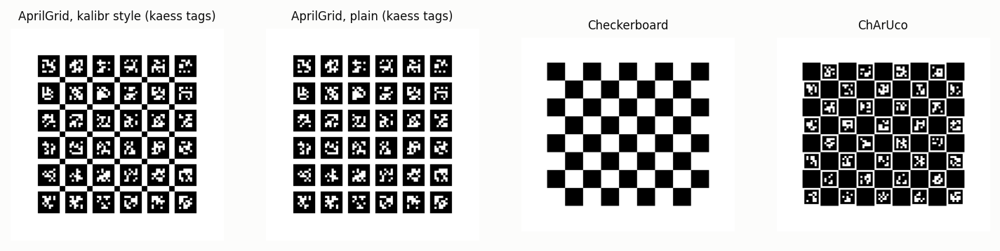
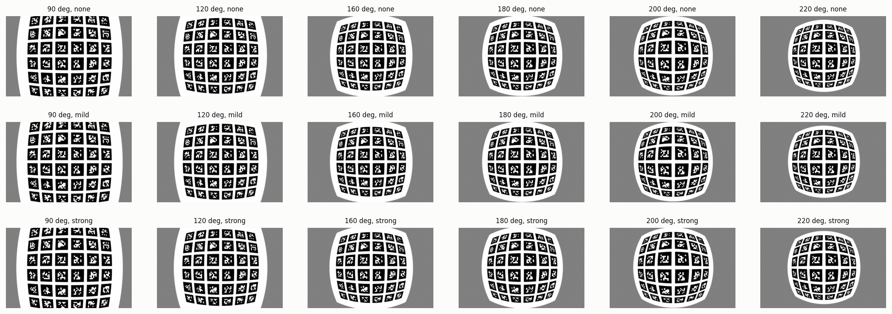
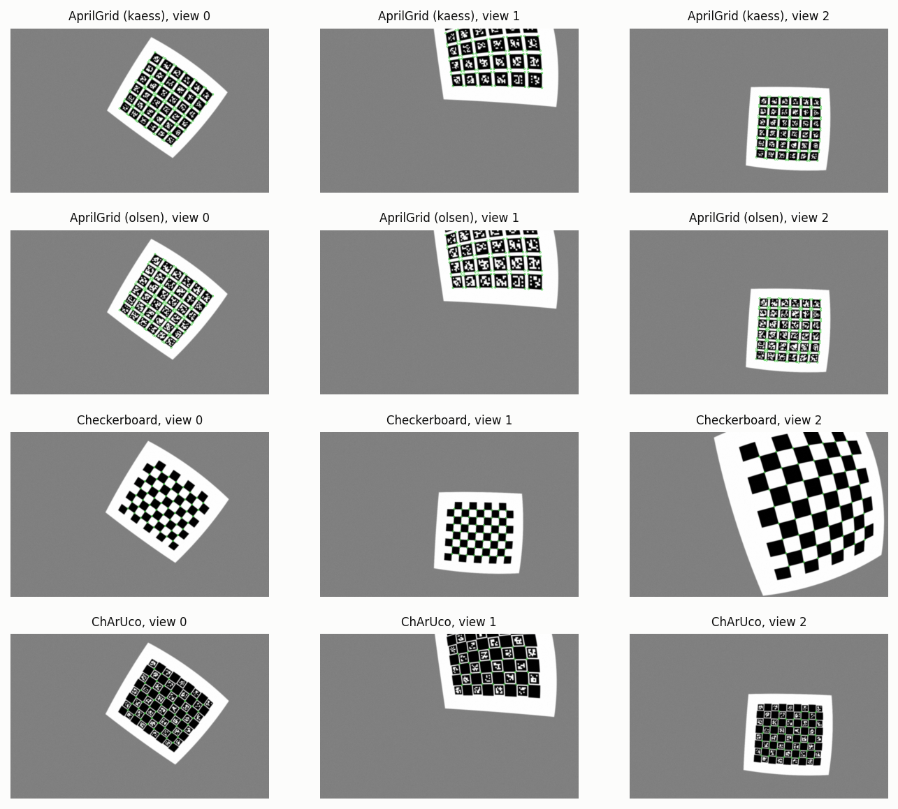
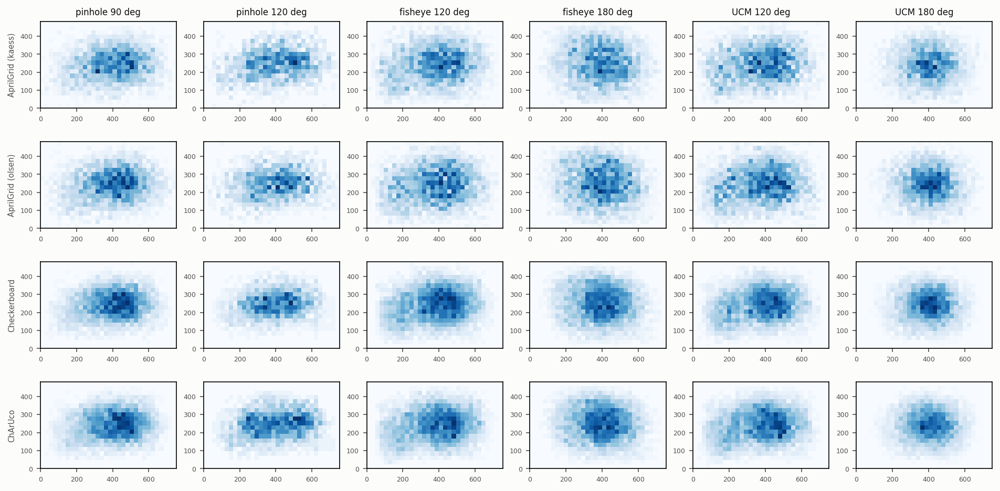

========================================================================
Camera calibration accuracy report
========================================================================

Corners of an AprilGrid, a checkerboard and a ChArUco board are detected in
simulated images of cameras with horizontal fields of view of
90, 120, 160, 180 degrees and different amounts of distortion,
and calibrated with ``CalibCamera``. The result is compared with the ground
truth camera.

Setup
=====

.. list-table::
   :header-rows: 1
   :align: center
   :width: 80%
   :widths: 40 60

   * - Setting
     - Value
   * - Resolution
     - 752x480
   * - Principal point offset
     - (+4.0, -3.0) px
   * - fy / fx
     - 1.004
   * - Views per camera and target
     - 80, random poses
   * - Distance to board
     - 90 deg: 0.5-1.5 m, 120 deg: 0.4-1.2 m, 160 deg: 0.3-0.8 m, 180 deg: 0.25-0.6 m
   * - Tilt
     - 0 - 60 deg
   * - Image
     - blur sigma 0.8 px, noise sigma 2.0 levels
   * - Corner refinement
     - cv::cornerSubPix for checkerboard, ChArUco
   * - Corners dropped beyond
     - 85 deg off the axis
   * - Seed
     - 42

Cameras, with three distortion levels each (none, mild, strong). The pinhole
camera does not exist at 180 degrees.

- **BrownConrady4**: pinhole with radial-tangential distortion, -3 % (mild) and
  -12 % (strong) radial distortion at the horizontal image edge.
- **KannalaBrandt4**: equidistant fisheye, ``k1..k4`` = [-0.005, 0.001, 0.0, 0.0]
  (mild) and [-0.03, 0.01, -0.002, 0.0002] (strong).

Targets, all with the detectors of ``lib/calib``:

- **AprilGrid**: 6x6 tags of 80 mm, detected with ``kaess`` and ``olsen``.
- **Checkerboard**: 9x8 squares of 70 mm. Its detector needs the whole board in
  the image, so only poses where the whole board is visible are used.
- **ChArUco**: 9x8 squares of 70 mm, 56 mm markers. It can be partly visible.

Both camera models project through the plane ``z = 1``, so corners 90 degrees or
more off the optical axis cannot be used.

   The calibration targets.

Camera views
============

A view of the board, looking straight at it, for each camera.

.. figure:: camera_views_BrownConrady4.png
   :width: 80%
   :align: center

   Pinhole + radial-tangential (BrownConrady4): rows are distortion levels, columns are fields of view.

   Equidistant fisheye (KannalaBrandt4): rows are distortion levels, columns are fields of view.

Calibration data
================

Detected corners (green) in three views of a 120 degree fisheye camera with strong distortion, and over all views (mild distortion).

   Three calibration views per target.

   Detected corners over the image, all views.

Results
=======

The **projection error** compares the estimated and the ground truth camera:
rays over the image are projected with both and the pixel difference is
measured (rms and max). A camera is *recovered* when the rms is at most
0.5 px. The best result of each row or column is in **bold**.

Quick summary
-------------

Default initial guess. Errors are medians over the cameras that converged.

.. list-table::
   :header-rows: 1
   :align: center
   :width: 80%

   * - Target
     - Fisheye: median error [px]
     - Pinhole 90-120 deg: median error [px]
     - Cameras recovered (<= 0.5 px)
     - Lowest error for cameras
     - Principal point: median error [px]
   * - AprilGrid (kaess)
     - 0.43
     - 0.13
     - 12 / 21
     - 2
     - **0.05**
   * - AprilGrid (olsen)
     - 0.37
     - 0.47
     - 13 / 21
     - 0
     - 0.15
   * - Checkerboard
     - **0.06**
     - **0.07**
     - **18 / 21**
     - **17**
     - **0.05**
   * - ChArUco
     - 0.14
     - 0.45
     - 17 / 21
     - 3
     - 0.16

- **Best:** Checkerboard, lowest error for 17 of 21 cameras, 18 of 21 recovered.

- **Fisheye:** every fisheye camera converges, median error 0.06 - 0.43 px, up to 180 degrees.

- **Pinhole at 160 degrees:** 4 of 12 calibrations converge from the default initial guess, 12 from a guess near the truth, so most failures are the initialisation, not the model.

- **Reprojection error is not accuracy:** BrownConrady4 at 160 degrees (AprilGrid (olsen)) reports 0.67 px but is off by 17.0 px.

Parameter errors
----------------

Median over the cameras that converged. ``fx`` is a relative error, the principal point ``cx, cy`` an absolute one.

.. list-table::
   :header-rows: 1
   :align: center
   :width: 80%

   * - Initial guess
     - Model
     - Target
     - fx error [%]
     - cx error [px]
     - cy error [px]
     - Reproj. rmse [px]
     - Converged
   * - default
     - BrownConrady4
     - AprilGrid (kaess)
     - **0.01**
     - **0.03**
     - **0.01**
     - 0.081
     - 6 / 9
   * - default
     - BrownConrady4
     - AprilGrid (olsen)
     - 0.10
     - 0.04
     - 0.07
     - 0.181
     - 7 / 9
   * - default
     - BrownConrady4
     - Checkerboard
     - **0.01**
     - **0.03**
     - 0.05
     - **0.073**
     - **9 / 9**
   * - default
     - BrownConrady4
     - ChArUco
     - 0.03
     - 0.17
     - 0.24
     - 0.213
     - 6 / 9
   * - default
     - KannalaBrandt4
     - AprilGrid (kaess)
     - 0.24
     - 0.04
     - **0.02**
     - 0.095
     - **12 / 12**
   * - default
     - KannalaBrandt4
     - AprilGrid (olsen)
     - 0.20
     - 0.09
     - 0.06
     - 0.159
     - **12 / 12**
   * - default
     - KannalaBrandt4
     - Checkerboard
     - **0.03**
     - **0.01**
     - 0.03
     - **0.044**
     - **12 / 12**
   * - default
     - KannalaBrandt4
     - ChArUco
     - **0.03**
     - 0.11
     - 0.05
     - 0.210
     - **12 / 12**
   * - near_truth
     - BrownConrady4
     - AprilGrid (kaess)
     - 0.03
     - 0.05
     - **0.03**
     - 0.089
     - **9 / 9**
   * - near_truth
     - BrownConrady4
     - AprilGrid (olsen)
     - 0.07
     - 0.21
     - 0.05
     - 0.203
     - **9 / 9**
   * - near_truth
     - BrownConrady4
     - Checkerboard
     - **0.01**
     - **0.03**
     - 0.05
     - **0.073**
     - **9 / 9**
   * - near_truth
     - BrownConrady4
     - ChArUco
     - 0.04
     - 0.21
     - 0.29
     - 0.238
     - **9 / 9**
   * - near_truth
     - KannalaBrandt4
     - AprilGrid (kaess)
     - 0.24
     - 0.04
     - **0.03**
     - 0.095
     - **12 / 12**
   * - near_truth
     - KannalaBrandt4
     - AprilGrid (olsen)
     - 0.20
     - 0.12
     - 0.06
     - 0.159
     - **12 / 12**
   * - near_truth
     - KannalaBrandt4
     - Checkerboard
     - **0.03**
     - **0.01**
     - **0.03**
     - **0.044**
     - **12 / 12**
   * - near_truth
     - KannalaBrandt4
     - ChArUco
     - **0.03**
     - 0.11
     - 0.05
     - 0.210
     - **12 / 12**

Default initial guess
---------------------

.. figure:: model_error_default.png
   :width: 80%
   :align: center

   Projection error (rms) by field of view. Crosses mark calibrations that diverged or failed.

.. list-table::
   :header-rows: 1
   :align: center
   :width: 80%

   * - Model
     - Distortion
     - FOV [deg]
     - AprilGrid (kaess)
     - AprilGrid (olsen)
     - Checkerboard
     - ChArUco
   * - BrownConrady4
     - none
     - 90
     - 0.19
     - 0.44
     - **0.05**
     - 0.41
   * - BrownConrady4
     - none
     - 120
     - 0.24
     - 0.88
     - **0.11**
     - 0.48
   * - BrownConrady4
     - none
     - 160
     - >100
     - >100
     - **3.53**
     - >100
   * - BrownConrady4
     - none
     - 180
     - n/a
     - n/a
     - n/a
     - n/a
   * - BrownConrady4
     - mild
     - 90
     - 0.11
     - 0.27
     - **0.07**
     - 0.34
   * - BrownConrady4
     - mild
     - 120
     - 0.15
     - 0.50
     - **0.04**
     - 0.49
   * - BrownConrady4
     - mild
     - 160
     - >100
     - >100
     - **1.46**
     - >100
   * - BrownConrady4
     - mild
     - 180
     - n/a
     - n/a
     - n/a
     - n/a
   * - BrownConrady4
     - strong
     - 90
     - **0.05**
     - 0.19
     - 0.06
     - 0.66
   * - BrownConrady4
     - strong
     - 120
     - **0.07**
     - 0.53
     - 0.08
     - 0.42
   * - BrownConrady4
     - strong
     - 160
     - >100
     - 16.98
     - **8.95**
     - >100
   * - BrownConrady4
     - strong
     - 180
     - n/a
     - n/a
     - n/a
     - n/a
   * - KannalaBrandt4
     - none
     - 90
     - 0.20
     - 0.22
     - **0.06**
     - 0.16
   * - KannalaBrandt4
     - none
     - 120
     - 0.34
     - 0.28
     - **0.07**
     - 0.20
   * - KannalaBrandt4
     - none
     - 160
     - 0.51
     - 0.43
     - **0.05**
     - 0.14
   * - KannalaBrandt4
     - none
     - 180
     - 0.70
     - 0.61
     - **0.04**
     - 0.05
   * - KannalaBrandt4
     - mild
     - 90
     - 0.20
     - 0.16
     - **0.05**
     - 0.20
   * - KannalaBrandt4
     - mild
     - 120
     - 0.34
     - 0.30
     - **0.07**
     - 0.24
   * - KannalaBrandt4
     - mild
     - 160
     - 0.51
     - 0.44
     - **0.05**
     - 0.14
   * - KannalaBrandt4
     - mild
     - 180
     - 0.66
     - 0.61
     - **0.11**
     - 0.14
   * - KannalaBrandt4
     - strong
     - 90
     - 0.22
     - 0.16
     - **0.04**
     - 0.16
   * - KannalaBrandt4
     - strong
     - 120
     - 0.36
     - 0.31
     - 0.32
     - **0.14**
   * - KannalaBrandt4
     - strong
     - 160
     - 0.51
     - 0.44
     - **0.09**
     - **0.09**
   * - KannalaBrandt4
     - strong
     - 180
     - 0.68
     - 0.63
     - 0.17
     - **0.10**

Initial guess near the ground truth
-----------------------------------

.. figure:: model_error_near_truth.png
   :width: 80%
   :align: center

   Projection error (rms) by field of view. Crosses mark calibrations that diverged or failed.

.. list-table::
   :header-rows: 1
   :align: center
   :width: 80%

   * - Model
     - Distortion
     - FOV [deg]
     - AprilGrid (kaess)
     - AprilGrid (olsen)
     - Checkerboard
     - ChArUco
   * - BrownConrady4
     - none
     - 90
     - 0.17
     - 0.51
     - **0.05**
     - 0.41
   * - BrownConrady4
     - none
     - 120
     - 0.29
     - 0.40
     - **0.11**
     - 0.48
   * - BrownConrady4
     - none
     - 160
     - **0.28**
     - 1.78
     - 3.53
     - 4.78
   * - BrownConrady4
     - none
     - 180
     - n/a
     - n/a
     - n/a
     - n/a
   * - BrownConrady4
     - mild
     - 90
     - 0.11
     - 0.61
     - **0.07**
     - 0.34
   * - BrownConrady4
     - mild
     - 120
     - 0.15
     - 0.36
     - **0.04**
     - 0.49
   * - BrownConrady4
     - mild
     - 160
     - **0.44**
     - 1.63
     - 1.46
     - 4.35
   * - BrownConrady4
     - mild
     - 180
     - n/a
     - n/a
     - n/a
     - n/a
   * - BrownConrady4
     - strong
     - 90
     - **0.05**
     - 0.73
     - 0.06
     - 0.66
   * - BrownConrady4
     - strong
     - 120
     - 0.21
     - 0.50
     - **0.08**
     - 0.42
   * - BrownConrady4
     - strong
     - 160
     - **1.51**
     - 3.19
     - 8.95
     - 3.61
   * - BrownConrady4
     - strong
     - 180
     - n/a
     - n/a
     - n/a
     - n/a
   * - KannalaBrandt4
     - none
     - 90
     - 0.21
     - 0.26
     - **0.06**
     - 0.16
   * - KannalaBrandt4
     - none
     - 120
     - 0.34
     - 0.44
     - **0.07**
     - 0.20
   * - KannalaBrandt4
     - none
     - 160
     - 0.51
     - 0.45
     - **0.05**
     - 0.14
   * - KannalaBrandt4
     - none
     - 180
     - 0.70
     - 0.61
     - **0.04**
     - 0.05
   * - KannalaBrandt4
     - mild
     - 90
     - 0.21
     - 0.19
     - **0.05**
     - 0.20
   * - KannalaBrandt4
     - mild
     - 120
     - 0.34
     - 0.34
     - **0.07**
     - 0.24
   * - KannalaBrandt4
     - mild
     - 160
     - 0.51
     - 0.44
     - **0.05**
     - 0.14
   * - KannalaBrandt4
     - mild
     - 180
     - 0.66
     - 0.61
     - **0.11**
     - 0.14
   * - KannalaBrandt4
     - strong
     - 90
     - 0.22
     - 0.18
     - **0.04**
     - 0.16
   * - KannalaBrandt4
     - strong
     - 120
     - 0.36
     - 0.31
     - 0.32
     - **0.14**
   * - KannalaBrandt4
     - strong
     - 160
     - 0.51
     - 0.44
     - **0.09**
     - **0.09**
   * - KannalaBrandt4
     - strong
     - 180
     - 0.68
     - 0.63
     - 0.17
     - **0.10**
