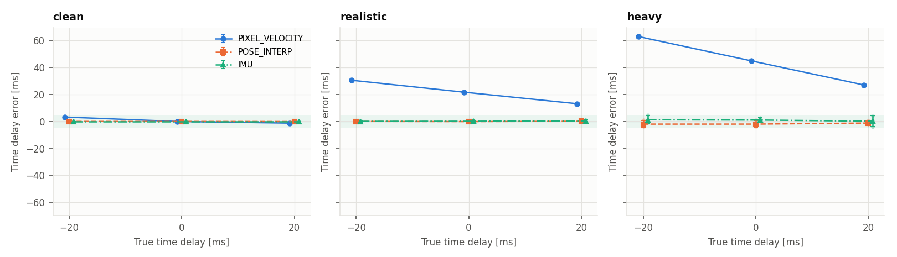

Camera-IMU time delay benchmark
===============================

How well does ``CalibCameraImu`` recover the time delay between a camera and an
IMU, and the extrinsic between them, with each of its time delay methods? The
data is simulated, so the ground truth is known. The time stamp of an IMU
measurement is its physical time plus the true delay.

Setup
-----

+-------------------+----------------------------------------------------------+
| Setting           | Value                                                    |
+===================+==========================================================+
| Dataset           | camera at 10 Hz and an IMU at 1 kHz, moving on a         |
|                   | ``fig8-horiz`` trajectory of radius 0.5 m for 10 s, in   |
|                   | front of an AprilGrid                                    |
+-------------------+----------------------------------------------------------+
| True delays       | -20 ms, +0 ms, +20 ms                                    |
+-------------------+----------------------------------------------------------+
| Initial extrinsic | ground truth moved by [0.1, 0.2, 0.3] m and rotated by   |
|                   | [0.0, 0.0, 30.0] deg (roll, pitch, yaw)                  |
+-------------------+----------------------------------------------------------+
| Datasets          | 3 per setting with noise, 1 without (the data is the     |
|                   | same for every seed)                                     |
+-------------------+----------------------------------------------------------+
| Solver            | at most 100 iterations                                   |
+-------------------+----------------------------------------------------------+
| Failure           | a time delay error above 5 ms                            |
+-------------------+----------------------------------------------------------+

Noise levels:

+-----------+--------------------+-------------------------+
| Level     | Corner noise (std) | IMU noise               |
+===========+====================+=========================+
| clean     | 0 px               | none                    |
+-----------+--------------------+-------------------------+
| realistic | 0.3 px             | 0.2 x the noise density |
+-----------+--------------------+-------------------------+
| heavy     | 0.3 px             | 1 x the noise density   |
+-----------+--------------------+-------------------------+

Time delay methods:

+----------------+-------------------------------------------------------------+
| Method         | How the time delay enters                                   |
+================+=============================================================+
| PIXEL_VELOCITY | Corrects each pixel with its velocity, the difference of    |
|                | the pixel in this view and in the previous one.             |
+----------------+-------------------------------------------------------------+
| POSE_INTERP    | Extrapolates the pose of the view to the camera time from   |
|                | the poses of this view and of the previous one.             |
+----------------+-------------------------------------------------------------+
| IMU            | The IMU error pre-integrates the IMU measurements in the    |
|                | window of the two views, shifted by the time delay. The     |
|                | camera errors do not use the time delay.                    |
+----------------+-------------------------------------------------------------+

Results
-------

Time delay error (estimate minus truth) against the true delay. Dots are single
datasets, lines are the mean and standard deviation, the shaded band is the
failure tolerance.

Overall, over all true delays:

+-----------+----------------+------+----------+-----------+----------+--------+
| Noise     | Method         | Runs | RMS [ms] | Mean [ms] | Max [ms] | Failed |
+===========+================+======+==========+===========+==========+========+
| clean     | PIXEL_VELOCITY | 3    | 2.02     | +0.69     | 3.28     | 0 / 3  |
+-----------+----------------+------+----------+-----------+----------+--------+
| clean     | POSE_INTERP    | 3    | 0.05     | -0.02     | 0.08     | 0 / 3  |
+-----------+----------------+------+----------+-----------+----------+--------+
| clean     | IMU            | 3    | 0.00     | -0.00     | 0.00     | 0 / 3  |
+-----------+----------------+------+----------+-----------+----------+--------+
| realistic | PIXEL_VELOCITY | 9    | 22.95    | +21.83    | 30.98    | 9 / 9  |
+-----------+----------------+------+----------+-----------+----------+--------+
| realistic | POSE_INTERP    | 9    | 0.50     | +0.02     | 0.72     | 0 / 9  |
+-----------+----------------+------+----------+-----------+----------+--------+
| realistic | IMU            | 9    | 0.50     | +0.23     | 1.04     | 0 / 9  |
+-----------+----------------+------+----------+-----------+----------+--------+
| heavy     | PIXEL_VELOCITY | 9    | 47.33    | +45.01    | 63.27    | 9 / 9  |
+-----------+----------------+------+----------+-----------+----------+--------+
| heavy     | POSE_INTERP    | 9    | 2.58     | -1.69     | 3.61     | 0 / 9  |
+-----------+----------------+------+----------+-----------+----------+--------+
| heavy     | IMU            | 9    | 2.70     | +0.84     | 4.85     | 0 / 9  |
+-----------+----------------+------+----------+-----------+----------+--------+

Solver iterations and time, on average:

+-----------+----------------+------------+-----------+
| Noise     | Method         | Iterations | Solve [s] |
+===========+================+============+===========+
| clean     | PIXEL_VELOCITY | 51         | 8.3       |
+-----------+----------------+------------+-----------+
| clean     | POSE_INTERP    | 49         | 6.7       |
+-----------+----------------+------------+-----------+
| clean     | IMU            | 50         | 8.8       |
+-----------+----------------+------------+-----------+
| realistic | PIXEL_VELOCITY | 45         | 4.9       |
+-----------+----------------+------------+-----------+
| realistic | POSE_INTERP    | 48         | 6.6       |
+-----------+----------------+------------+-----------+
| realistic | IMU            | 56         | 8.9       |
+-----------+----------------+------------+-----------+
| heavy     | PIXEL_VELOCITY | 64         | 11.7      |
+-----------+----------------+------------+-----------+
| heavy     | POSE_INTERP    | 67         | 9.6       |
+-----------+----------------+------------+-----------+
| heavy     | IMU            | 79         | 12.5      |
+-----------+----------------+------------+-----------+

Per true delay:

clean
~~~~~

+----------------+--------+------+---------+--------+---------+--------+-------+
| Method         | True   | Runs | Mean    | Std    | Max     | Failed | Iter. |
|                | [ms]   |      | error   | [ms]   | error   |        |       |
|                |        |      | [ms]    |        | [ms]    |        |       |
+================+========+======+=========+========+=========+========+=======+
| PIXEL_VELOCITY | -20    | 1    | +3.28   | 0.00   | 3.28    | 0 / 1  | 53    |
+----------------+--------+------+---------+--------+---------+--------+-------+
| PIXEL_VELOCITY | +0     | 1    | +0.00   | 0.00   | 0.00    | 0 / 1  | 45    |
+----------------+--------+------+---------+--------+---------+--------+-------+
| PIXEL_VELOCITY | +20    | 1    | -1.22   | 0.00   | 1.22    | 0 / 1  | 56    |
+----------------+--------+------+---------+--------+---------+--------+-------+
| POSE_INTERP    | -20    | 1    | +0.02   | 0.00   | 0.02    | 0 / 1  | 47    |
+----------------+--------+------+---------+--------+---------+--------+-------+
| POSE_INTERP    | +0     | 1    | +0.00   | 0.00   | 0.00    | 0 / 1  | 48    |
+----------------+--------+------+---------+--------+---------+--------+-------+
| POSE_INTERP    | +20    | 1    | -0.08   | 0.00   | 0.08    | 0 / 1  | 51    |
+----------------+--------+------+---------+--------+---------+--------+-------+
| IMU            | -20    | 1    | -0.00   | 0.00   | 0.00    | 0 / 1  | 54    |
+----------------+--------+------+---------+--------+---------+--------+-------+
| IMU            | +0     | 1    | -0.00   | 0.00   | 0.00    | 0 / 1  | 49    |
+----------------+--------+------+---------+--------+---------+--------+-------+
| IMU            | +20    | 1    | -0.00   | 0.00   | 0.00    | 0 / 1  | 47    |
+----------------+--------+------+---------+--------+---------+--------+-------+

realistic
~~~~~~~~~

+----------------+-------+------+----------+--------+---------+--------+-------+
| Method         | True  | Runs | Mean     | Std    | Max     | Failed | Iter. |
|                | [ms]  |      | error    | [ms]   | error   |        |       |
|                |       |      | [ms]     |        | [ms]    |        |       |
+================+=======+======+==========+========+=========+========+=======+
| PIXEL_VELOCITY | -20   | 3    | +30.57   | 0.30   | 30.98   | 3 / 3  | 48    |
+----------------+-------+------+----------+--------+---------+--------+-------+
| PIXEL_VELOCITY | +0    | 3    | +21.72   | 0.34   | 22.17   | 3 / 3  | 36    |
+----------------+-------+------+----------+--------+---------+--------+-------+
| PIXEL_VELOCITY | +20   | 3    | +13.20   | 0.27   | 13.57   | 3 / 3  | 53    |
+----------------+-------+------+----------+--------+---------+--------+-------+
| POSE_INTERP    | -20   | 3    | +0.03    | 0.46   | 0.66    | 0 / 3  | 43    |
+----------------+-------+------+----------+--------+---------+--------+-------+
| POSE_INTERP    | +0    | 3    | -0.10    | 0.56   | 0.66    | 0 / 3  | 44    |
+----------------+-------+------+----------+--------+---------+--------+-------+
| POSE_INTERP    | +20   | 3    | +0.13    | 0.44   | 0.72    | 0 / 3  | 55    |
+----------------+-------+------+----------+--------+---------+--------+-------+
| IMU            | -20   | 3    | +0.09    | 0.37   | 0.55    | 0 / 3  | 57    |
+----------------+-------+------+----------+--------+---------+--------+-------+
| IMU            | +0    | 3    | +0.17    | 0.45   | 0.80    | 0 / 3  | 56    |
+----------------+-------+------+----------+--------+---------+--------+-------+
| IMU            | +20   | 3    | +0.44    | 0.42   | 1.04    | 0 / 3  | 56    |
+----------------+-------+------+----------+--------+---------+--------+-------+

heavy
~~~~~

+----------------+-------+------+----------+--------+---------+--------+-------+
| Method         | True  | Runs | Mean     | Std    | Max     | Failed | Iter. |
|                | [ms]  |      | error    | [ms]   | error   |        |       |
|                |       |      | [ms]     |        | [ms]    |        |       |
+================+=======+======+==========+========+=========+========+=======+
| PIXEL_VELOCITY | -20   | 3    | +62.95   | 0.23   | 63.27   | 3 / 3  | 65    |
+----------------+-------+------+----------+--------+---------+--------+-------+
| PIXEL_VELOCITY | +0    | 3    | +44.97   | 0.19   | 45.23   | 3 / 3  | 62    |
+----------------+-------+------+----------+--------+---------+--------+-------+
| PIXEL_VELOCITY | +20   | 3    | +27.09   | 0.12   | 27.25   | 3 / 3  | 64    |
+----------------+-------+------+----------+--------+---------+--------+-------+
| POSE_INTERP    | -20   | 3    | -1.96    | 2.18   | 3.61    | 0 / 3  | 63    |
+----------------+-------+------+----------+--------+---------+--------+-------+
| POSE_INTERP    | +0    | 3    | -1.95    | 2.13   | 3.59    | 0 / 3  | 71    |
+----------------+-------+------+----------+--------+---------+--------+-------+
| POSE_INTERP    | +20   | 3    | -1.16    | 1.29   | 2.21    | 0 / 3  | 68    |
+----------------+-------+------+----------+--------+---------+--------+-------+
| IMU            | -20   | 3    | +1.27    | 2.57   | 4.85    | 0 / 3  | 79    |
+----------------+-------+------+----------+--------+---------+--------+-------+
| IMU            | +0    | 3    | +1.04    | 1.29   | 2.87    | 0 / 3  | 75    |
+----------------+-------+------+----------+--------+---------+--------+-------+
| IMU            | +20   | 3    | +0.20    | 3.29   | 4.03    | 0 / 3  | 84    |
+----------------+-------+------+----------+--------+---------+--------+-------+

Camera-IMU extrinsic
--------------------

Error of the estimated extrinsic, mean over the runs. The extrinsic is estimated
together with the time delay.

+-----------+----------------+---------------+----------------+
| Noise     | Method         | Position [mm] | Rotation [deg] |
+===========+================+===============+================+
| clean     | PIXEL_VELOCITY | 5.3           | 0.021          |
+-----------+----------------+---------------+----------------+
| clean     | POSE_INTERP    | 5.4           | 0.008          |
+-----------+----------------+---------------+----------------+
| clean     | IMU            | 0.0           | 0.000          |
+-----------+----------------+---------------+----------------+
| realistic | PIXEL_VELOCITY | 22.0          | 0.254          |
+-----------+----------------+---------------+----------------+
| realistic | POSE_INTERP    | 22.2          | 0.045          |
+-----------+----------------+---------------+----------------+
| realistic | IMU            | 23.3          | 0.043          |
+-----------+----------------+---------------+----------------+
| heavy     | PIXEL_VELOCITY | 112.9         | 0.442          |
+-----------+----------------+---------------+----------------+
| heavy     | POSE_INTERP    | 104.9         | 0.238          |
+-----------+----------------+---------------+----------------+
| heavy     | IMU            | 108.0         | 0.228          |
+-----------+----------------+---------------+----------------+

Notes
-----

- ``PIXEL_VELOCITY`` takes the pixel velocity from the pixels of two views. With
  noisy pixels the correction of a pixel is a blend of its own noise and the
  noise of the previous view, which is the smallest for a delay of half the time
  between views, so least squares is pulled towards that delay, whatever the
  true one is. Even without noise a difference of two views is only a first
  order velocity.
- ``POSE_INTERP`` extrapolates from the estimated poses, not from the pixels, so
  the noise of the pixels does not enter the correction.
- ``IMU`` integrates the IMU measurements that are in the shifted window, so the
  noise in them is the noise its covariance expects, and the time delay is not
  pulled anywhere by it. It needs IMU measurements before and after the window,
  as much as the largest delay.
- The noise densities of the simulated IMU (0.08 m/s^2/sqrt(Hz), 0.004
  rad/s/sqrt(Hz)) are 20 - 40 times those of a typical MEMS IMU, the ``heavy``
  level uses them as they are.
