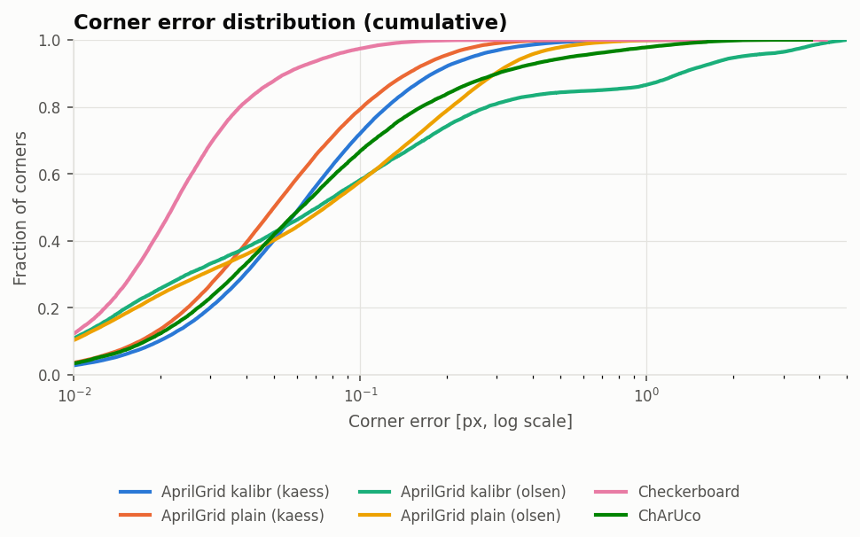
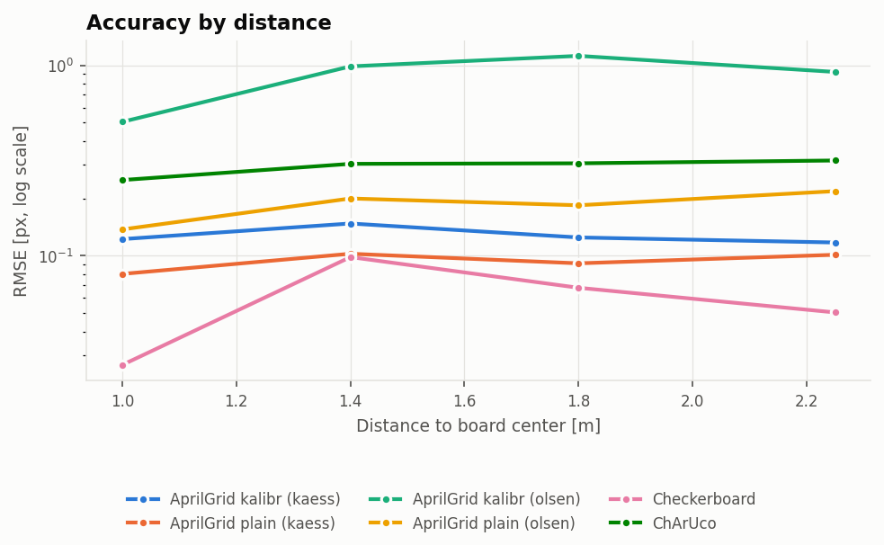
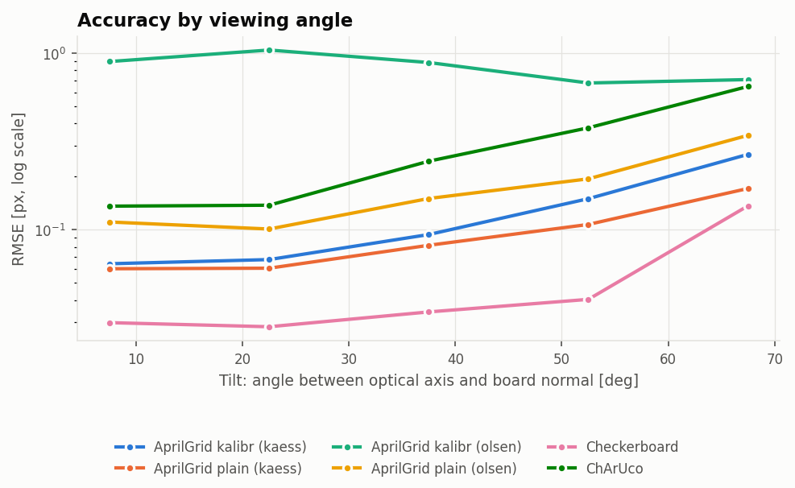
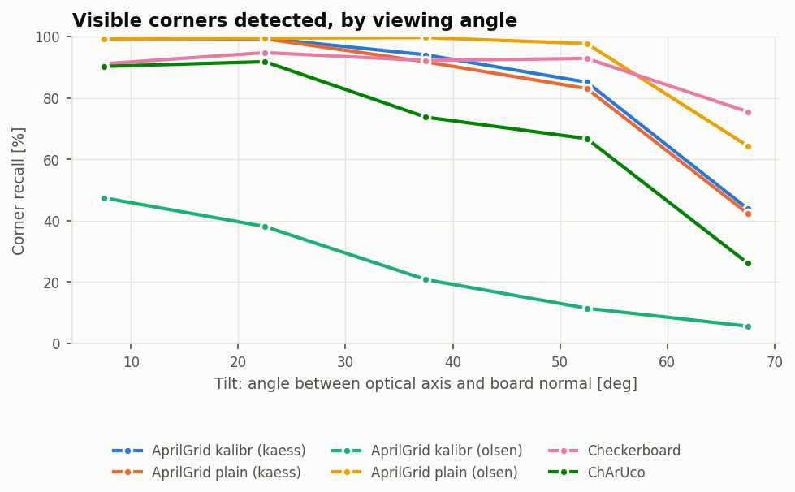
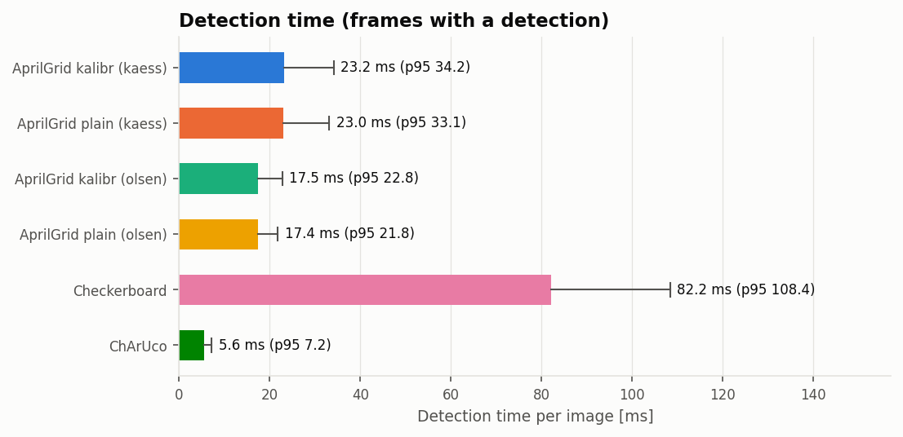

# Detector accuracy report

Synthetic experiment: a camera at 500 random poses in front of each
calibration target, rendered by ray casting every pixel onto the board plane so
the true corner locations are known exactly. Every target is viewed from the
same poses.

In the tables the best result of each column is in bold: the lowest error or
time and the highest detection rate or recall.

## Setup

| Setting | Value |
|---|---|
| Camera | 752x480, 60 deg horizontal FOV, distortion: False |
| Distance to board | 0.8 - 2.5 m |
| Viewing angle (tilt) | 0 - 75 deg, random roll and azimuth |
| Image | blur sigma 0.8 px, noise sigma 2.0 levels, 2x supersampled |
| Outlier threshold | corner error > 5.0 px |
| Corner refinement | cv::cornerSubPix for checkerboard, ChArUco |
| Seed | 42 |

Targets: AprilGrid 6x6 (tag 80 mm, spacing 25 %) with black squares between
tags (kalibr style) and without, each with the `kaess` (ethz_apriltag, AprilTag
1) and `olsen` (apriltag, AprilTag 3) detectors; a 9x8 checkerboard
(`findChessboardCornersSB`); a 9x8 ChArUco board (OpenCV `CharucoDetector`).
Squares are 70 mm.

## Accuracy

Corner error is the distance in pixels between the detected corner and the true
projection, over every detected corner whose error is within the outlier
threshold.

| Target | Corners | RMSE [px] | Bias [px] | Precision [px] | Median [px] | p95 [px] | p99 [px] |
|---|---:|---:|---:|---:|---:|---:|---:|
| AprilGrid kalibr (kaess) | 60,082 | 0.128 | **0.000** | 0.128 | 0.062 | 0.247 | 0.450 |
| AprilGrid plain (kaess) | 59,163 | 0.093 | **0.000** | 0.093 | 0.050 | 0.193 | 0.301 |
| AprilGrid kalibr (olsen) | 17,164 | 0.916 | 0.005 | 0.916 | 0.071 | 2.132 | 4.143 |
| AprilGrid plain (olsen) | 65,805 | 0.187 | 0.002 | 0.187 | 0.076 | 0.381 | 0.639 |
| Checkerboard | 24,976 | **0.065** | **0.000** | **0.065** | **0.022** | **0.078** | **0.131** |
| ChArUco | 19,292 | 0.289 | 0.012 | 0.288 | 0.062 | 0.552 | 1.402 |

- **RMSE** is the overall error. It splits into **bias** (the constant offset
  of the mean error vector) and **precision** (the random scatter around that
  offset): RMSE^2 = bias^2 + precision^2.
- The median, p95 and p99 columns are the corner error magnitude percentiles.

RMSE [px] by distance to the board center:

| Target | 0.8-1.2 m | 1.2-1.6 m | 1.6-2 m | 2-2.5 m |
|---|---:|---:|---:|---:|
| AprilGrid kalibr (kaess) | 0.122 | 0.148 | 0.125 | 0.117 |
| AprilGrid plain (kaess) | 0.080 | 0.102 | 0.091 | 0.101 |
| AprilGrid kalibr (olsen) | 0.505 | 0.987 | 1.121 | 0.923 |
| AprilGrid plain (olsen) | 0.137 | 0.200 | 0.184 | 0.218 |
| Checkerboard | **0.027** | **0.098** | **0.068** | **0.050** |
| ChArUco | 0.250 | 0.304 | 0.306 | 0.316 |

RMSE [px] by viewing angle (tilt):

| Target | 0-15 deg | 15-30 deg | 30-45 deg | 45-60 deg | 60-75 deg |
|---|---:|---:|---:|---:|---:|
| AprilGrid kalibr (kaess) | 0.064 | 0.068 | 0.094 | 0.150 | 0.267 |
| AprilGrid plain (kaess) | 0.060 | 0.061 | 0.082 | 0.107 | 0.171 |
| AprilGrid kalibr (olsen) | 0.897 | 1.042 | 0.885 | 0.678 | 0.709 |
| AprilGrid plain (olsen) | 0.111 | 0.101 | 0.150 | 0.194 | 0.343 |
| Checkerboard | **0.030** | **0.028** | **0.034** | **0.040** | **0.137** |
| ChArUco | 0.136 | 0.138 | 0.245 | 0.378 | 0.648 |

A "-" means fewer than 30 detected corners in that bin, so it is also left out
of the lines.

## Detection

| Target | Poses | Detected [%] | Corner recall [%] | Outliers [%] |
|---|---:|---:|---:|---:|
| AprilGrid kalibr (kaess) | 500 | 94.6 | 84.0 | **0.0** |
| AprilGrid plain (kaess) | 500 | 94.4 | 82.7 | **0.0** |
| AprilGrid kalibr (olsen) | 500 | 95.8 | 23.9 | 1.3 |
| AprilGrid plain (olsen) | 500 | **98.4** | **91.9** | **0.0** |
| Checkerboard | 500 | 89.2 | 89.2 | 1.5 |
| ChArUco | 500 | 91.0 | 69.0 | **0.0** |

- **Detected** is the share of poses with at least one correct corner.
- **Corner recall** is the average share of the visible corners that were
  detected correctly. Checkerboard and ChArUco only report a corner when the
  pattern is found.
- **Outliers** are detected corners with an error above the threshold, as a
  share of all detections.

## Detection time

Time of one `detect()` call on one 752x480 image, measured on the machine that
ran the experiment (single run, wall clock). The `kaess` detector is
single-threaded; `olsen` uses 2 threads and OpenCV may parallelise internally.

| Target | Mean [ms] | Median [ms] | p95 [ms] | Mean incl. misses [ms] |
|---|---:|---:|---:|---:|
| AprilGrid kalibr (kaess) | 24.9 | 23.2 | 34.2 | 24.5 |
| AprilGrid plain (kaess) | 24.5 | 23.0 | 33.1 | 24.1 |
| AprilGrid kalibr (olsen) | 16.9 | 17.5 | 22.8 | 17.0 |
| AprilGrid plain (olsen) | 16.7 | 17.4 | 21.8 | 16.8 |
| Checkerboard | 83.8 | 82.2 | 108.4 | 88.1 |
| ChArUco | **5.5** | **5.6** | **7.2** | **5.2** |

The first three columns cover images where the detector returned corners, and
the last one all images, since a miss can be much faster or slower than a hit.

## Notes

- Colours follow the target and are the first six slots of the reference
  categorical palette in order. I could not run the palette validator on this
  machine (the installed Node is too old), so colour separation was not
  re-checked. Every line is labelled in a legend and the numbers behind each
  chart are in the tables.
- This is a simulation. It has no motion blur, lighting, lens flare or print
  defects, so absolute numbers are best read as relative comparisons.
