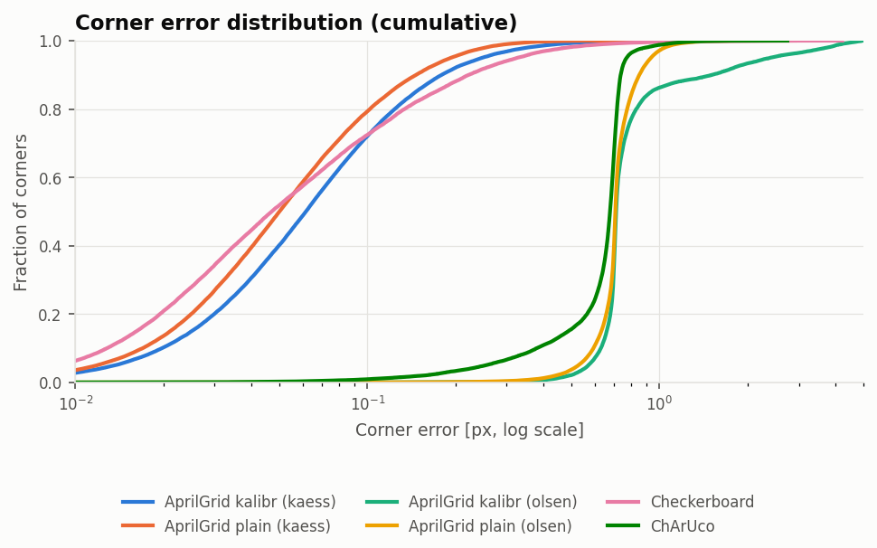
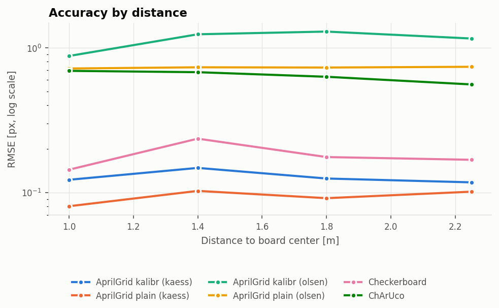
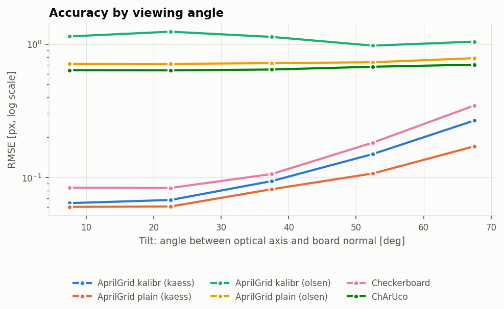
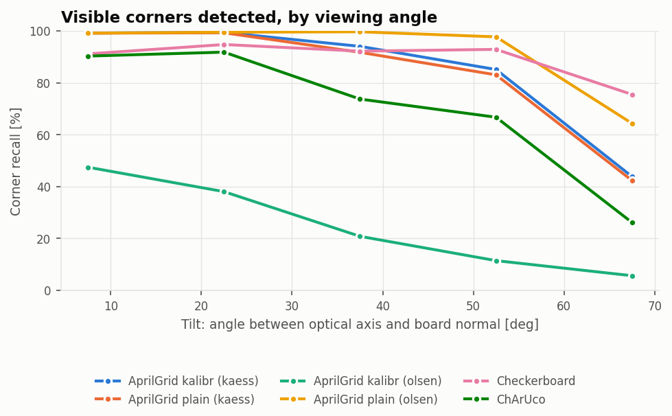
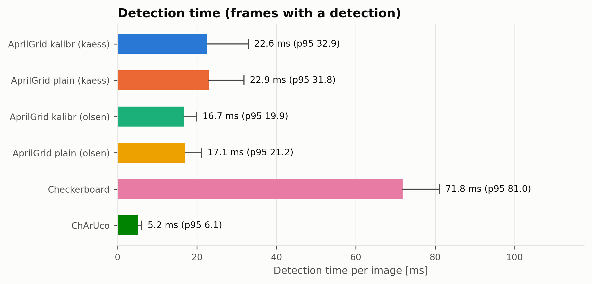

========================================================================
Detector accuracy report
========================================================================

Simulated images of each calibration target from 500 random camera poses,
so the true corner locations are known. Every target is seen from the same
poses. The best result of each column is in **bold**. It is a simulation, with
no motion blur, lighting or print defects, so read the numbers as relative.

Setup
=====

.. list-table::
   :header-rows: 1
   :align: center
   :width: 80%
   :widths: 30 70

   * - Setting
     - Value
   * - Camera
     - 752x480, 60 deg horizontal FOV, distortion: False
   * - Distance to board
     - 0.8 - 2.5 m
   * - Viewing angle (tilt)
     - 0 - 75 deg, random roll and azimuth
   * - Image
     - blur sigma 0.8 px, noise sigma 2.0 levels, 2x supersampled
   * - Outlier threshold
     - corner error > 5.0 px
   * - Corner refinement
     - cv::cornerSubPix for checkerboard, ChArUco
   * - Seed
     - 42

Targets: AprilGrid 6x6 (tags of 80 mm), kalibr style (black squares between
the tags) and plain, with the ``kaess`` and ``olsen`` detectors; a 9x8
checkerboard and a 9x8 ChArUco board (squares of 70 mm).

Results
=======

Summary
-------

.. list-table::
   :header-rows: 1
   :align: center
   :width: 80%

   * - Target
     - RMSE [px]
     - Detected [%]
     - Corner recall [%]
     - Median time [ms]
   * - AprilGrid kalibr (kaess)
     - 0.128
     - 94.6
     - 84.0
     - 23.2
   * - AprilGrid plain (kaess)
     - 0.093
     - 94.4
     - 82.7
     - 23.0
   * - AprilGrid kalibr (olsen)
     - 0.916
     - 95.8
     - 23.9
     - 17.5
   * - AprilGrid plain (olsen)
     - 0.187
     - **98.4**
     - **91.9**
     - 17.4
   * - Checkerboard
     - **0.065**
     - 89.2
     - 89.2
     - 82.2
   * - ChArUco
     - 0.289
     - 91.0
     - 69.0
     - **5.6**

- **Most accurate:** Checkerboard, 0.065 px rms (95 % of its corners within 0.08 px).

- **Most corners found:** AprilGrid plain (olsen) finds 91.9 % of the visible corners, and detects the board in 98.4 % of the poses.

- **Fastest and slowest:** ChArUco at 5.6 ms (median), Checkerboard at 82.2 ms.

- **Black squares between the tags:** they cost olsen most of its corners (23.9 % recall on the kalibr style grid, 91.9 % on the plain grid), while kaess is 84.0 % and 82.7 %.

Accuracy
--------

Corner error: distance between the detected and the true corner, over the
corners within the outlier threshold. RMSE\ :sup:`2` = bias\ :sup:`2` +
precision\ :sup:`2`.

.. list-table::
   :header-rows: 1
   :align: center
   :width: 80%

   * - Target
     - Corners
     - RMSE [px]
     - Bias [px]
     - Precision [px]
     - Median [px]
     - p95 [px]
     - p99 [px]
   * - AprilGrid kalibr (kaess)
     - 60,082
     - 0.128
     - **0.000**
     - 0.128
     - 0.062
     - 0.247
     - 0.450
   * - AprilGrid plain (kaess)
     - 59,163
     - 0.093
     - **0.000**
     - 0.093
     - 0.050
     - 0.193
     - 0.301
   * - AprilGrid kalibr (olsen)
     - 17,164
     - 0.916
     - 0.005
     - 0.916
     - 0.071
     - 2.132
     - 4.143
   * - AprilGrid plain (olsen)
     - 65,805
     - 0.187
     - 0.002
     - 0.187
     - 0.076
     - 0.381
     - 0.639
   * - Checkerboard
     - 24,976
     - **0.065**
     - **0.000**
     - **0.065**
     - **0.022**
     - **0.078**
     - **0.131**
   * - ChArUco
     - 19,292
     - 0.289
     - 0.012
     - 0.288
     - 0.062
     - 0.552
     - 1.402

   Corner error distribution (cumulative).

   Accuracy by distance to the board center.

RMSE [px] by distance [m]:

.. list-table::
   :header-rows: 1
   :align: center
   :width: 80%

   * - Target
     - 0.8-1.2 m
     - 1.2-1.6 m
     - 1.6-2 m
     - 2-2.5 m
   * - AprilGrid kalibr (kaess)
     - 0.122
     - 0.148
     - 0.125
     - 0.117
   * - AprilGrid plain (kaess)
     - 0.080
     - 0.102
     - 0.091
     - 0.101
   * - AprilGrid kalibr (olsen)
     - 0.505
     - 0.987
     - 1.121
     - 0.923
   * - AprilGrid plain (olsen)
     - 0.137
     - 0.200
     - 0.184
     - 0.218
   * - Checkerboard
     - **0.027**
     - **0.098**
     - **0.068**
     - **0.050**
   * - ChArUco
     - 0.250
     - 0.304
     - 0.306
     - 0.316

   Accuracy by viewing angle (tilt).

RMSE [px] by tilt [deg]:

.. list-table::
   :header-rows: 1
   :align: center
   :width: 80%

   * - Target
     - 0-15 deg
     - 15-30 deg
     - 30-45 deg
     - 45-60 deg
     - 60-75 deg
   * - AprilGrid kalibr (kaess)
     - 0.064
     - 0.068
     - 0.094
     - 0.150
     - 0.267
   * - AprilGrid plain (kaess)
     - 0.060
     - 0.061
     - 0.082
     - 0.107
     - 0.171
   * - AprilGrid kalibr (olsen)
     - 0.897
     - 1.042
     - 0.885
     - 0.678
     - 0.709
   * - AprilGrid plain (olsen)
     - 0.111
     - 0.101
     - 0.150
     - 0.194
     - 0.343
   * - Checkerboard
     - **0.030**
     - **0.028**
     - **0.034**
     - **0.040**
     - **0.137**
   * - ChArUco
     - 0.136
     - 0.138
     - 0.245
     - 0.378
     - 0.648

A "-" means fewer than 30 detected corners.

Detection
---------

.. list-table::
   :header-rows: 1
   :align: center
   :width: 80%

   * - Target
     - Poses
     - Detected [%]
     - Corner recall [%]
     - Outliers [%]
   * - AprilGrid kalibr (kaess)
     - 500
     - 94.6
     - 84.0
     - **0.0**
   * - AprilGrid plain (kaess)
     - 500
     - 94.4
     - 82.7
     - **0.0**
   * - AprilGrid kalibr (olsen)
     - 500
     - 95.8
     - 23.9
     - 1.3
   * - AprilGrid plain (olsen)
     - 500
     - **98.4**
     - **91.9**
     - **0.0**
   * - Checkerboard
     - 500
     - 89.2
     - 89.2
     - 1.5
   * - ChArUco
     - 500
     - 91.0
     - 69.0
     - **0.0**

Detected: poses with at least one correct corner. Corner recall: share of the
visible corners found. Outliers: corners with an error above the threshold.

   Corner recall by viewing angle.

Detection time
--------------

Time of one ``detect()`` call on a 752x480 image. The last column includes the
images where nothing was detected.

.. list-table::
   :header-rows: 1
   :align: center
   :width: 80%

   * - Target
     - Mean [ms]
     - Median [ms]
     - p95 [ms]
     - Mean incl. misses [ms]
   * - AprilGrid kalibr (kaess)
     - 24.9
     - 23.2
     - 34.2
     - 24.5
   * - AprilGrid plain (kaess)
     - 24.5
     - 23.0
     - 33.1
     - 24.1
   * - AprilGrid kalibr (olsen)
     - 16.9
     - 17.5
     - 22.8
     - 17.0
   * - AprilGrid plain (olsen)
     - 16.7
     - 17.4
     - 21.8
     - 16.8
   * - Checkerboard
     - 83.8
     - 82.2
     - 108.4
     - 88.1
   * - ChArUco
     - **5.5**
     - **5.6**
     - **7.2**
     - **5.2**

   Detection time per image (median, with the 95th percentile).

